
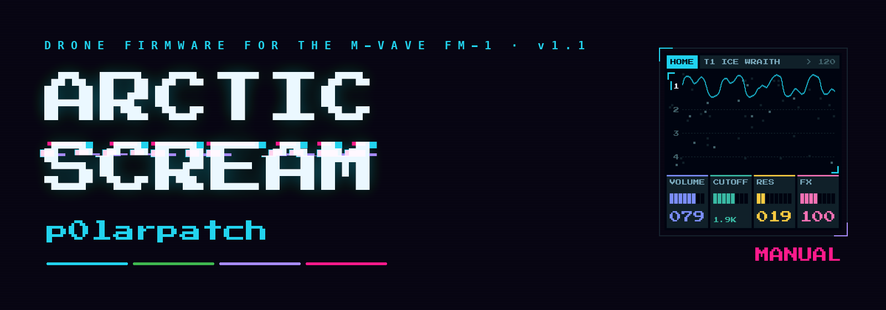

# Arctic Scream p0larpatch: the manual

**Version 1.1, for the M-VAVE FM-1.** Every picture here is the FM-1's own screen, taken from the firmware itself
(`tools/make_screens.py`).

> **Try it as you read:** the [demo](https://polarpatch.github.io/Arctic-scream-FM-1/) runs the same code in your
> browser. Every button and combo is also on one page in the
> [cheat sheet](https://polarpatch.github.io/Arctic-scream-FM-1/cheatsheet.html).

| | |
|---|---|
| [01 · The basics](#01--the-basics) | [07 · Sequencer](#07--sequencer-seq-play-rec) |
| [02 · HOME](#02--home) | [08 · Slots, sounds and songs](#08--slots-sounds-and-songs-save-glo) |
| [03 · Sources: EDIT](#03--sources-edit) | [09 · Destroy: FX](#09--destroy-fx) |
| [04 · DRONE](#04--drone-a-sound-that-lives-on-its-own) | [10 · Perform: hold FX](#10--perform-hold-fx) |
| [05 · ENV and LFO](#05--env-and-lfo) | [11 · System: hold HOME](#11--system-hold-home) |
| [06 · Scales, chords, arpeggiator](#06--scales-chords-and-the-arpeggiator-sel-arp) | [12 · Factory sounds](#12--factory-sounds) · [13 · Combos](#13--combos-at-a-glance) · [14 · Editor and demo](#14--the-editor-and-the-demo) |

---

## 01 · The basics

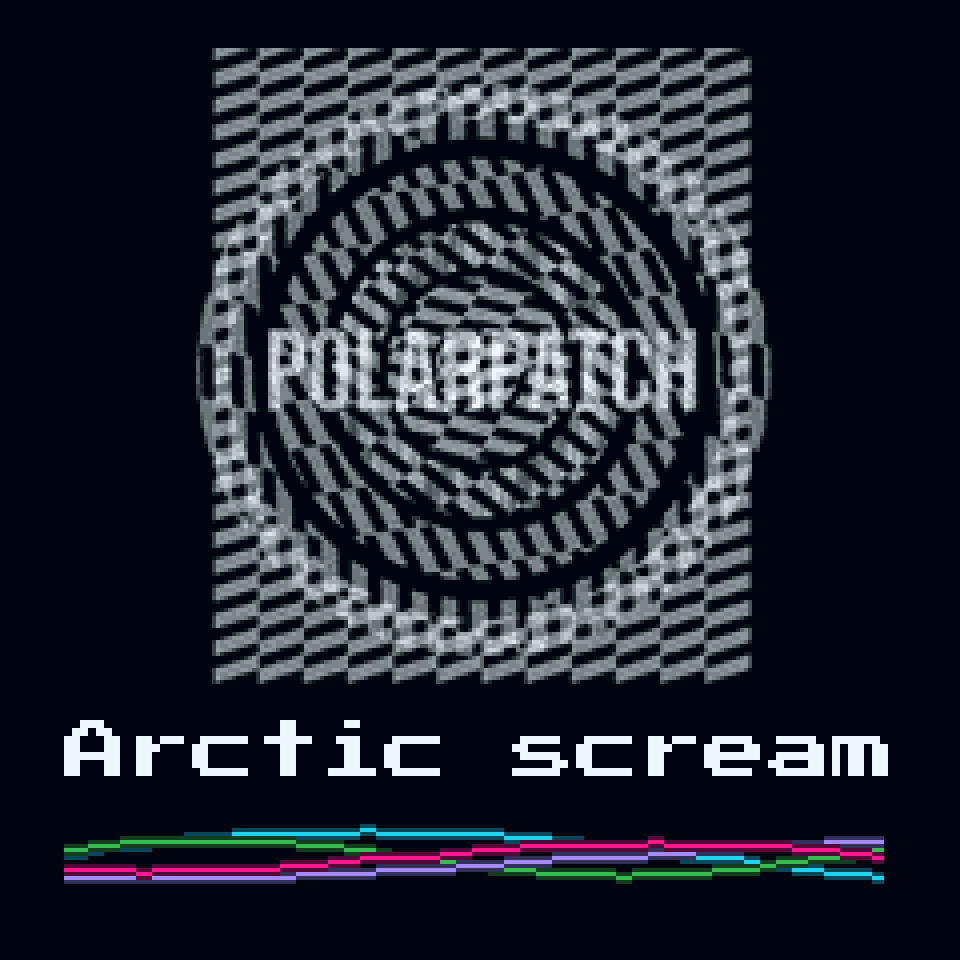

Arctic Scream has **four tracks, T1–T4**. Each track plays its own sound, has its own sequence and goes through the
shared effects. **Six voices** are shared by all four.

Every track starts with **ICE WRAITH**, a Holvut sound that holds its notes: press a low key and let it howl.

| Control | What it does |
|---|---|
| **ALGORITHM** | Picks the track (T1–T4). Every page shows that track. |
| **PRESETS** | Loads the next or previous sound into the track. On the sequencer pages: the tempo. |
| **SELECT** | On HOME: the tempo. On the sequencer: the cursor. |
| **KNOB 1–4** | The four values along the bottom of the screen, on every page. |
| **MASTER** | Volume. |
| **OCT− / OCT+** | Octave down and up. In save menus: back and confirm. |
| **Keys** | Play the track. The first white key is **F2**: everything sits an octave down, for drones. |

- **Pages:** tap a button for its first page, again for the next. The header shows where you are, e.g. `FX > DELAY`.
  Many buttons do more when **held** while you press a key or turn a knob (see [13 · Combos](#13--combos-at-a-glance)).
- **Knobs speed up:** turn slowly for fine steps, fast to sweep.
- **LATCH ON:** a key starts its note, the same key again stops it.
- **Saving is automatic.** When the sequencer is stopped and everything is silent, your work saves itself, and it comes
  back at power-on as you left it. A latched note never goes silent: the header says `SAVES WHEN SILENT` until you let
  it go.
- **Undo:** hold **EDIT** and press **OCT−**; **OCT+** redoes.

 

---

## 02 · HOME

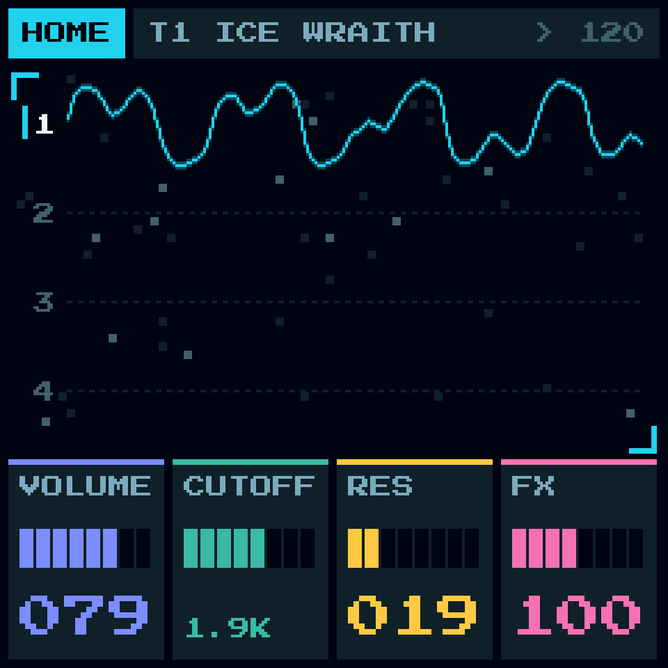

Each track's wave glows on HOME as it plays, under a starry sky. The header shows the track, its sound and the tempo.

| KNOB 1 | KNOB 2 | KNOB 3 | KNOB 4 |
|---|---|---|---|
| VOLUME | CUTOFF | RESONANCE | FX |

- **CUTOFF / RESONANCE:** a low-pass filter at the end of the track, for every source.
- **FX:** all three effect sends of the track together: 0 dry, 100 % as set on MIXER 1, 200 % twice as wet.

Press **HOME** again for the mixers. MIXER 1 draws each track as a curtain of standing ribbons, MIXER 2 as a ribbon
across the stereo field.

| Page | KNOB 1 | KNOB 2 | KNOB 3 | KNOB 4 |
|---|---|---|---|---|
| MIXER 1 | LEVEL | DLY SEND | REV SEND | GRAIN SEND |
| MIXER 2 | PAN | | | |

 

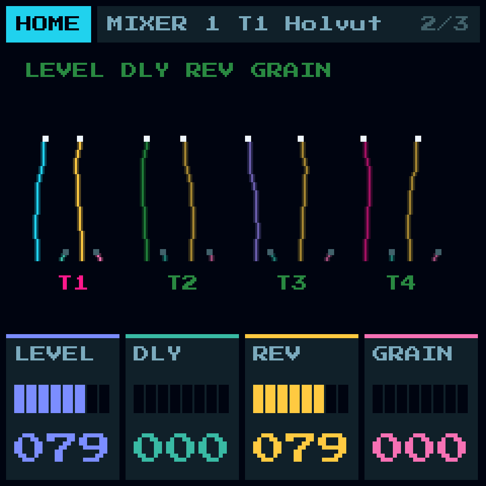

---

## 03 · Sources: EDIT

**EDIT** opens the track's **SOUND** page (the source's four knobs), then **SOURCE**. An FM track has two more pages.

| SOUND: Holvut | SOURCE |
|---|---|
| 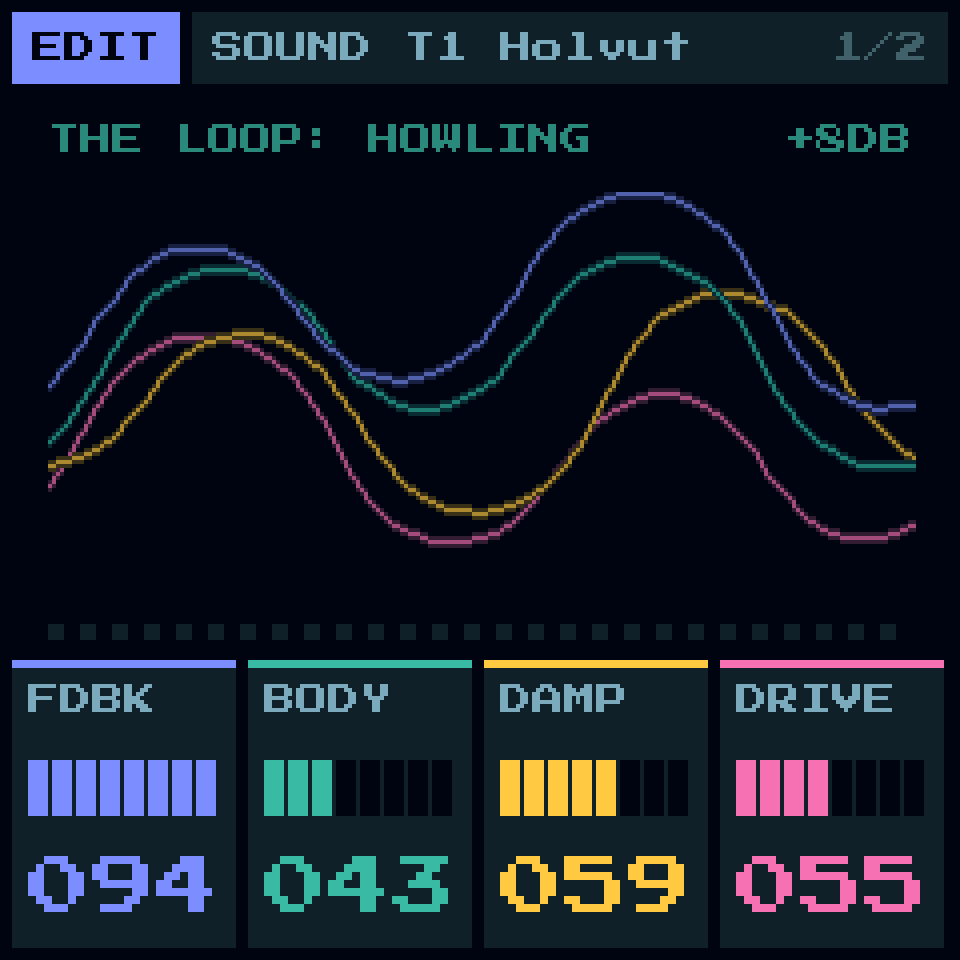 | 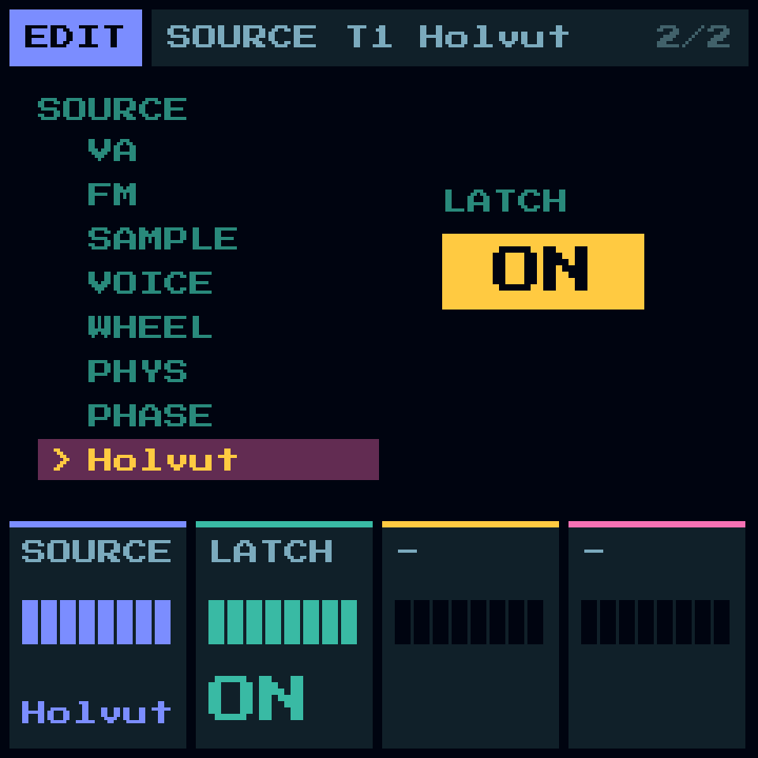 |

**SOURCE:** KNOB 1 picks the source, KNOB 2 sets LATCH.

| Source | KNOB 1 | KNOB 2 | KNOB 3 | KNOB 4 | What it is |
|---|---|---|---|---|---|
| **Holvut** | FEEDBACK | BODY | DAMP | DRIVE | A feedback loop that howls by itself |
| **VA** | WAVE | DETUNE | CUTOFF | RESONANCE | Virtual analog: saw, square, supersaw |
| **FM** | PATCH | BRIGHT | DECAY | DETUNE | Six operators, 32 algorithms, its own patch |
| **SAMPLE** | SLOT | START | LENGTH | REVERSE | Your own WAVs in four slots, played as a loop |
| **VOICE** | VOWEL | SHIFT | BUZZ | BREATH | A singing formant voice |
| **WHEEL** | DRAWBARS | PERC | CLICK | DRIVE | A tonewheel organ |
| **PHYS** | MODEL | STRUCTURE | DAMP | BOW | Bowed and struck strings, bars, plates, membranes |
| **PHASE** | WAVE | WAVE2 | DCW | DETUNE | Phase distortion |

### Holvut, the feedback voice

*Holvut* is North Sami for "to howl". A string and a resonant body sit inside a loop with saturation, filters and
diffusion. Nothing is struck.

- **Below the threshold the loop sleeps.** Past it, at about two thirds of FEEDBACK, it wakes, grows out of silence
  and howls by itself. The screen says `THE LOOP: ASLEEP` or `HOWLING`.
- **Each key sends a burst into the loop**, so a note played near the threshold sets it off.
- **FEEDBACK** wakes it, **BODY** bends it, **DAMP** turns the scream into a growl, **DRIVE** tears it.
- Its four aurora ribbons move with the knobs.
- **III** is a horrorscape: three Holvut voices in a CLUSTER chord, a semitone rubbing in it, dark and slowly waking.
  Hold a key around C4. Turn **DAMP** down to let it scream, **BODY** to bend it, **FEEDBACK** to wake or calm it.

### The other sources

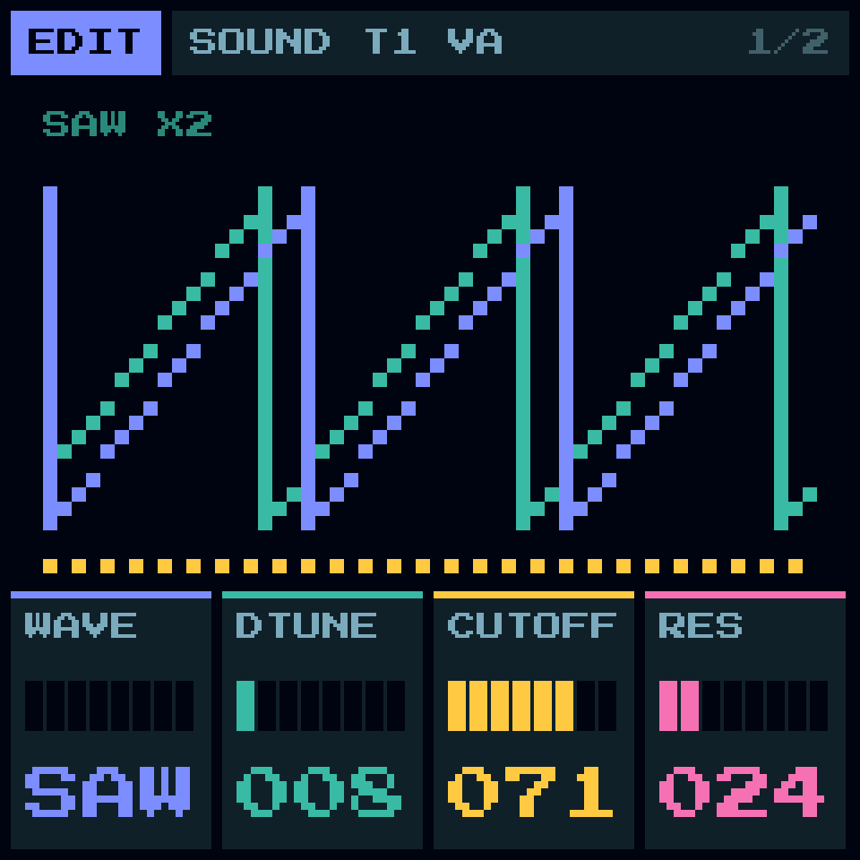

- **SAMPLE:** the four slots are yours: load WAVs from the [editor](#14--the-editor-and-the-demo). An empty slot is
  silent. No samples are built in, and samples already on your FM-1 stay.
- **PHYS:** STRUCTURE and BOW change meaning with the model; the screen shows the current name.

 

**FM tracks:** EDIT steps **SOUND → FM ALGO → FM OP → SOURCE**. The screen draws how the six operators are wired:
carriers (the ones you hear) outlined, modulators filled, the selected one lit.

| Page | KNOB 1 | KNOB 2 | KNOB 3 | KNOB 4 |
|---|---|---|---|---|
| FM ALGO | ALGO (1–32) | FEEDBACK | OP (1–6) | FINE |
| FM OP | RATIO | LEVEL | ATTACK | DECAY |

| FM ALGO | FM OP |
|---|---|
| 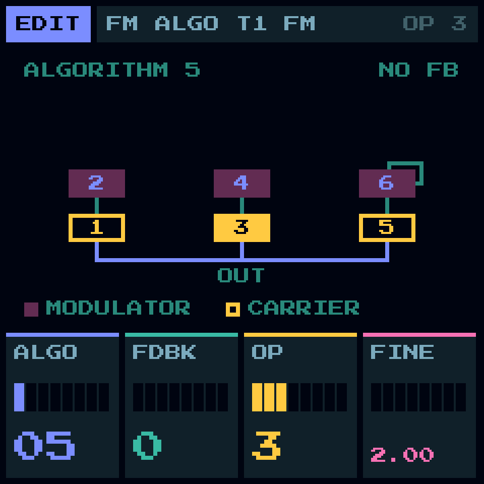 | 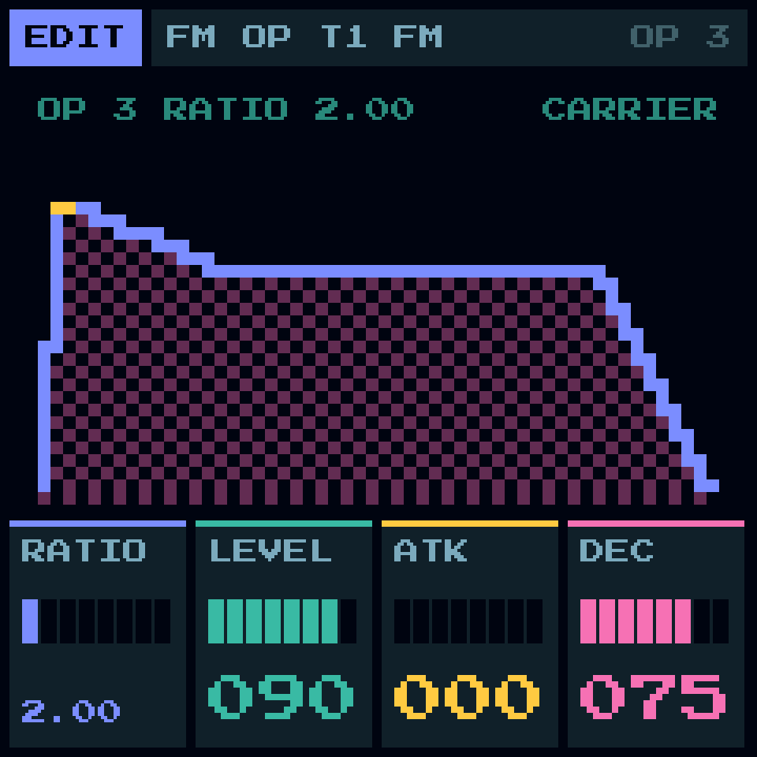 |

---

## 04 · DRONE: a sound that lives on its own

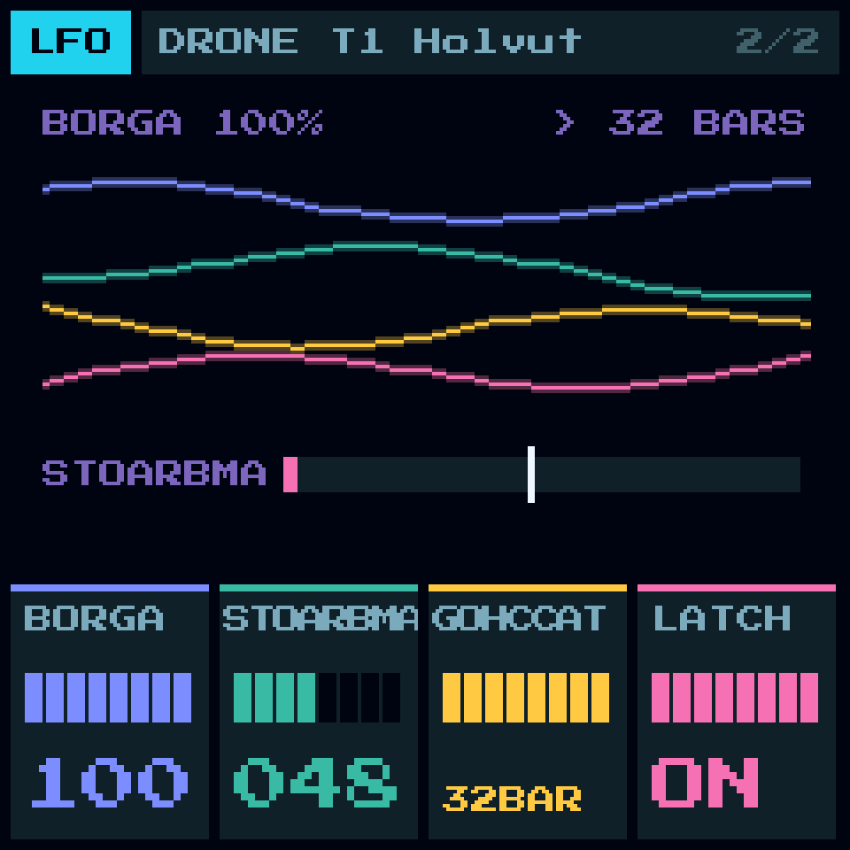

**Press LFO twice.** DRONE makes a held sound move by itself, slowly, and never the same way twice. The knobs have
North Sami names.

| KNOB 1 | KNOB 2 | KNOB 3 | KNOB 4 |
|---|---|---|---|
| **BORGA** (snowdrift) | **STOARBMA** (storm) | **GOHCCÁT** (to wake) | LATCH |

- **BORGA, 0–100 %:** four slow random walks move the filter, the source's shape, its most natural knob (on Holvut:
  FEEDBACK, around the threshold) and the reverb's distance. Each voice drifts a few cents and breathes, so a held
  chord sounds like a choir.
- **STOARBMA, 0–100 %:** the tension. It opens the filter, raises resonance and drive, spreads the voices and makes the
  walks deeper and faster.
- **GOHCCÁT, OFF or 1–32 bars:** how long the storm takes to rise, in tempo. A drone woken from silence starts calm
  and builds.
- **At 0 % nothing is added.** The settings are saved with the sound. The seven Holvut presets start with BORGA on.
- The screen draws the four walks as aurora ribbons and the storm as a bar with its target.

 

---

## 05 · ENV and LFO

| ENV | LFO |
|---|---|
| 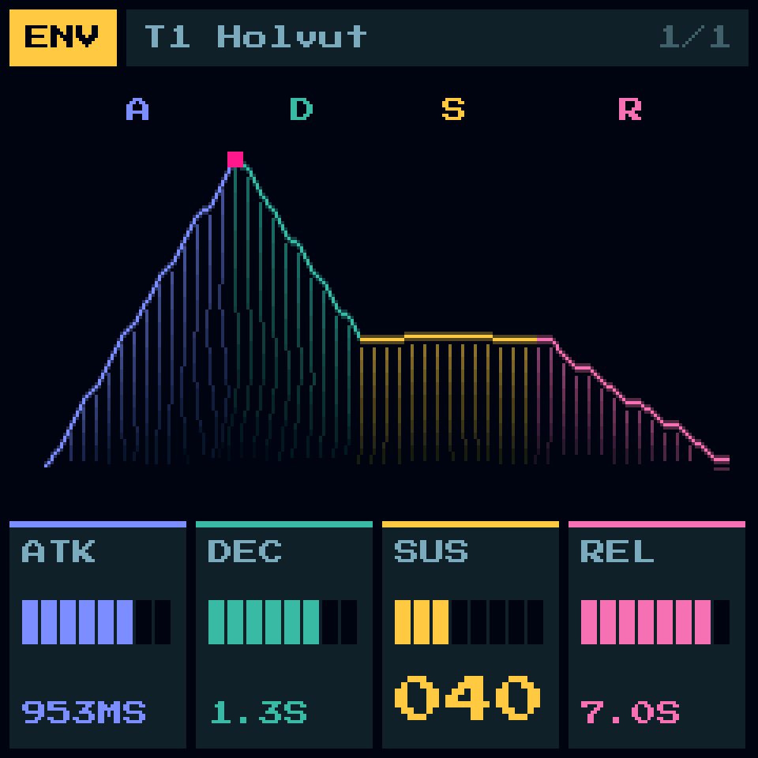 | 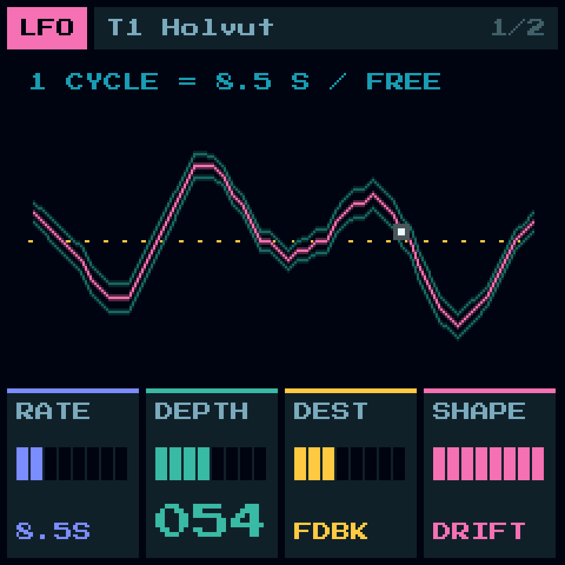 |

**ENV** (per track): how each note starts and ends. The envelope hangs as a curtain, each stage in its colour.

| KNOB 1 | KNOB 2 | KNOB 3 | KNOB 4 |
|---|---|---|---|
| ATTACK (~1 ms – 10 s) | DECAY (~10 ms – 10 s) | SUSTAIN (40 % to start) | RELEASE (~10 ms – 20 s) |

**LFO** (per track): slow movement. It never restarts with a note, so drones keep breathing.

| KNOB 1 | KNOB 2 | KNOB 3 | KNOB 4 |
|---|---|---|---|
| RATE (60 s a cycle – 20 Hz) | DEPTH (0 = off) | DESTINATION | SHAPE |

- **Destinations:** PITCH, VOLUME, PAN, the source's four knobs by name, REV SEND, GRAIN SEND, the track's CUTOFF.
- **Shapes:** SINE, TRIANGLE, SAW UP, SAW DOWN, SQUARE, RANDOM, DRIFT.

---

## 06 · Scales, chords and the arpeggiator: SEL, ARP

| SCALE | CHORD |
|---|---|
| 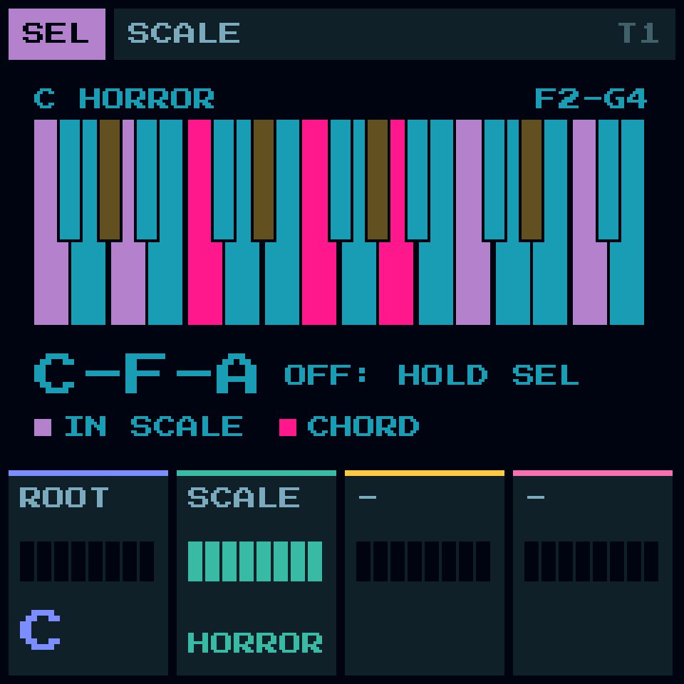 SCALE: C HORROR" width="320"> | 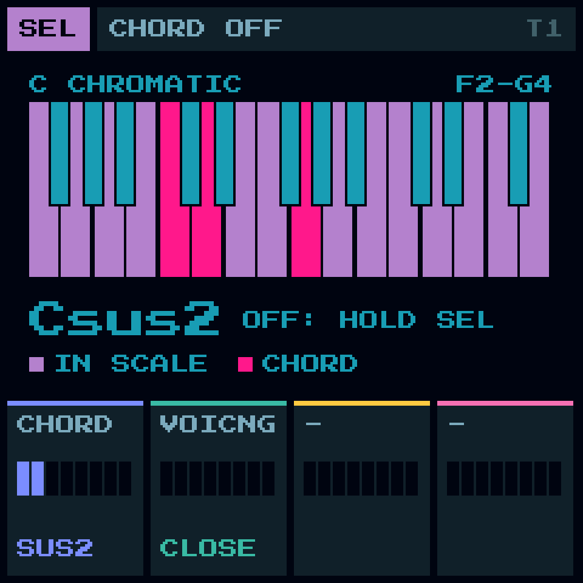 CHORD" width="320"> |

**SEL** opens **SCALE → CHORD**. **Hold SEL** (and let go) for chord mode on or off: one key, a whole chord.

| Page | KNOB 1 | KNOB 2 |
|---|---|---|
| SCALE | ROOT (C–B) | SCALE |
| CHORD | CHORD TYPE | VOICING |

- **SCALE**, shared by all tracks: OFF and fourteen scales, the last of them **HORROR**: close semitones, every note
  wrong in the right way. With a scale set, keys, MIDI and recordings snap to it.
- **CHORD TYPE:** SCALE (the scale's own chord), MIN, MAJ, SUS2, SUS4, FIFTH, MIN7, MAJ7, DIM, ADD9, CLUSTER.
- **VOICING:** CLOSE, OPEN, SPREAD, +OCT, DROP. Big chords use more of the six voices.

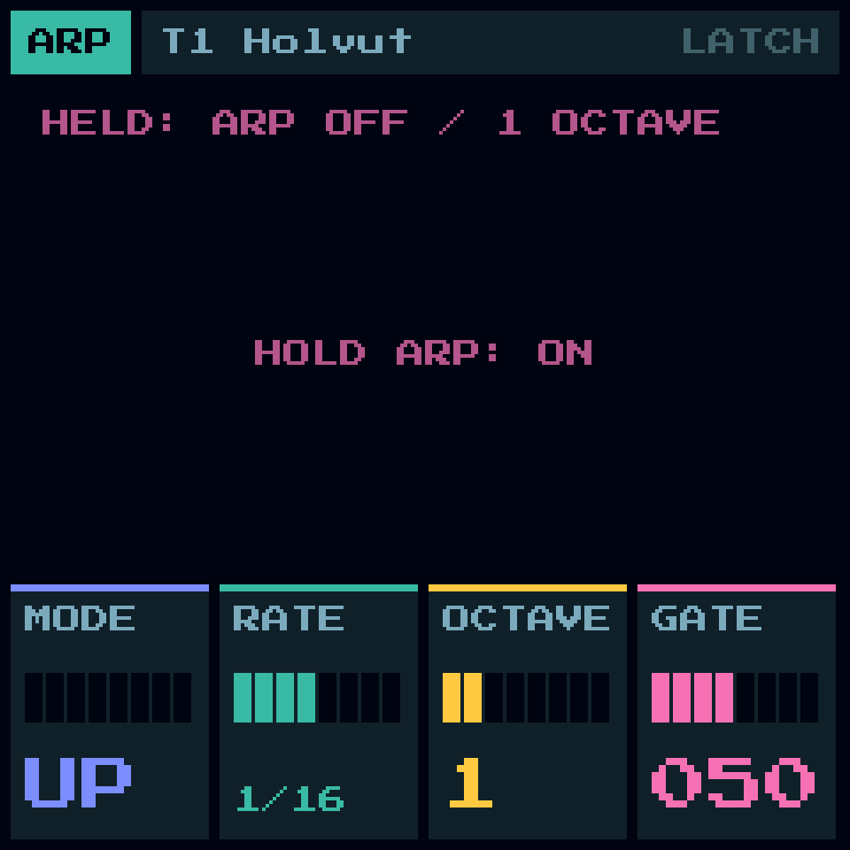

**ARP** opens the arpeggiator; **hold ARP** to switch it on or off for the track.

| KNOB 1 | KNOB 2 | KNOB 3 | KNOB 4 |
|---|---|---|---|
| MODE | RATE | OCTAVES (1–4) | GATE |

- **Modes:** UP, DOWN, UP-DOWN, RANDOM, AS PLAYED, CHORD. **Rates:** 1/1 to 1/32, and triplets.
- It plays the keys you hold. With LATCH ON it keeps going after you let go.
- It follows the sequencer's clock while it plays.

 

---

## 07 · Sequencer: SEQ, PLAY, REC

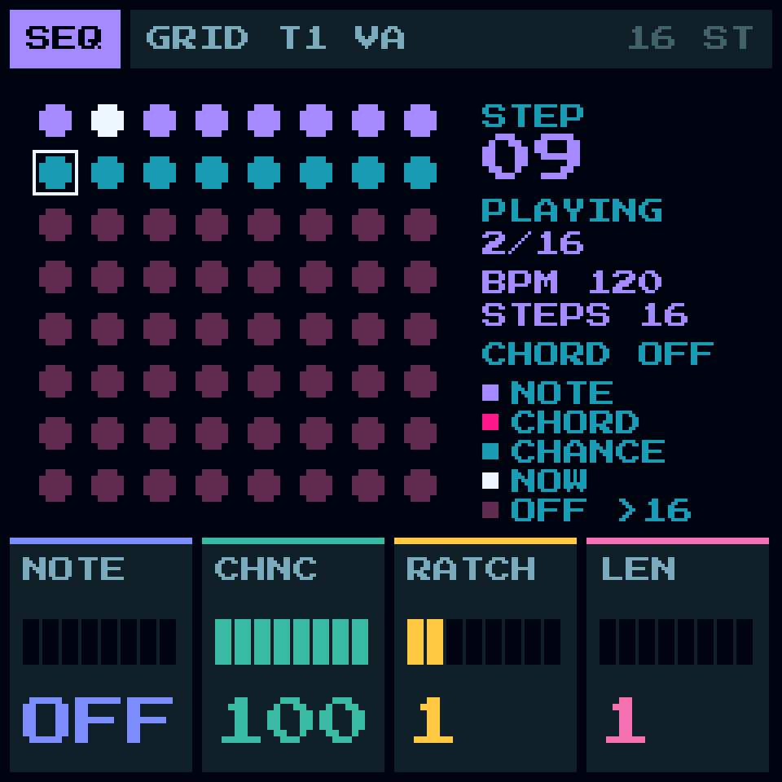 GRID: eight steps recorded, playing" width="360" align="right">

Each track has its own **64-step** pattern; all four play together on one tempo (20–300 BPM).
**SEQ** opens **GRID → PATTERN SETTINGS**, **PLAY/STOP** starts and stops, **REC** records.

**GRID**, the selected step:

| KNOB 1 | KNOB 2 | KNOB 3 | KNOB 4 |
|---|---|---|---|
| NOTE (all the way down = OFF) | CHANCE | RATCHET (1–4) | LENGTH |

**PATTERN SETTINGS:**

| KNOB 1 | KNOB 2 | KNOB 3 | KNOB 4 |
|---|---|---|---|
| STEPS (1–64) | DIVISION | SWING | PLAY MODE |

 

- **SELECT** moves the cursor; **hold SEQ + turn SELECT** sets the length. **PRESETS** sets the tempo.
- **Stopped + REC:** each key fills a step and moves on. **Playing + REC:** notes land on the nearest step.
- **Step locks:** hold **SEL** and turn a knob to lock that value to the step. **SEL + OCT−** clears them.
- **Hold SEQ + a white key** (all undoable):

| key 1 | key 2 | key 3 | key 4 | key 5 | key 6 | key 7 | key 8 |
|---|---|---|---|---|---|---|---|
| CLEAR | RANDOM | SHIFT ← | SHIFT → | COPY | PASTE | DOUBLE | MUTATE |

*(The white keys are counted from the left, from F2.)*

---

## 08 · Slots, sounds and songs: SAVE, GLO

### Slots A–D

A slot holds the four tracks' sounds, sequences, locks and mix.

- **Hold SAVE + keys 1–4:** recall A–D (at the next bar while playing). **Keys 5–8:** save into A–D; press again
  within 3 seconds to overwrite.
- **SAVE → PROJECTS:** SLOT and ACTION (LOAD, SAVE, ERASE, NEW), confirmed with **OCT+**.

### Your own sounds

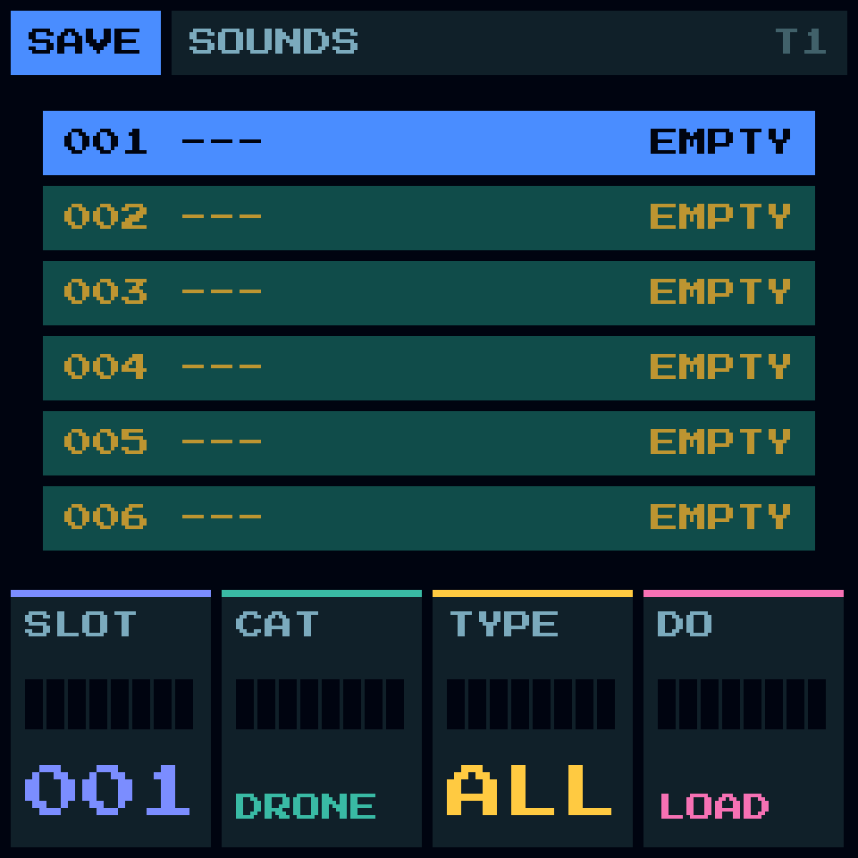 SOUNDS" width="300" align="right">

**SAVE → SOUNDS:** 64 slots for your own sounds. A sound keeps its source and knobs, ENV, LFO, DRONE, LATCH, chord
and (FM) its patch.

| KNOB 1 | KNOB 2 | KNOB 3 | KNOB 4 |
|---|---|---|---|
| SLOT | CATEGORY | TYPE | ACTION: LOAD / SAVE / CLEAR |

Confirm with **OCT+**, back out with **OCT−**. Saved sounds come in PRESETS after the factory sounds of their category.
Name them in the [editor](#14--the-editor-and-the-demo) (up to 10 characters).

 

### Songs: GLO

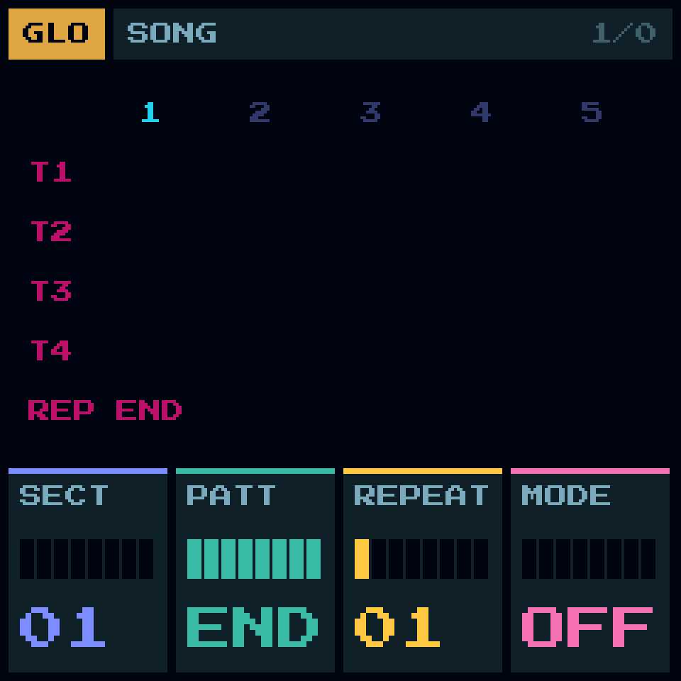 SONG" width="300" align="right">

**GLO** opens **SONG**: a chain of up to 16 steps, each a slot and its repeats.

| KNOB 1 | KNOB 2 | KNOB 3 | KNOB 4 |
|---|---|---|---|
| SECTION | PATTERN (A–D / END) | REPEATS (1–16) | MODE |

- **MODE:** OFF (PLAY loops the slot), SONG (once), SONG LOOP.
- **Record a song:** on SONG press **REC**, then **PLAY**, and switch slots with SAVE + keys 1–4.
- **Hold GLO + keys 1–4** mutes T1–T4, **keys 5–8** solos them.

 

Arctic Scream keeps its own saves, separate from other FM-1 firmwares.

---

## 09 · Destroy: FX

**FX** steps through **TAPE → GRAIN → DELAY → SPACE**. Tracks feed GRAIN, DELAY and SPACE through their sends; TAPE
colours the whole mix at the end. Each page has its own northern lights.

| TAPE | GRAIN |
|---|---|
| 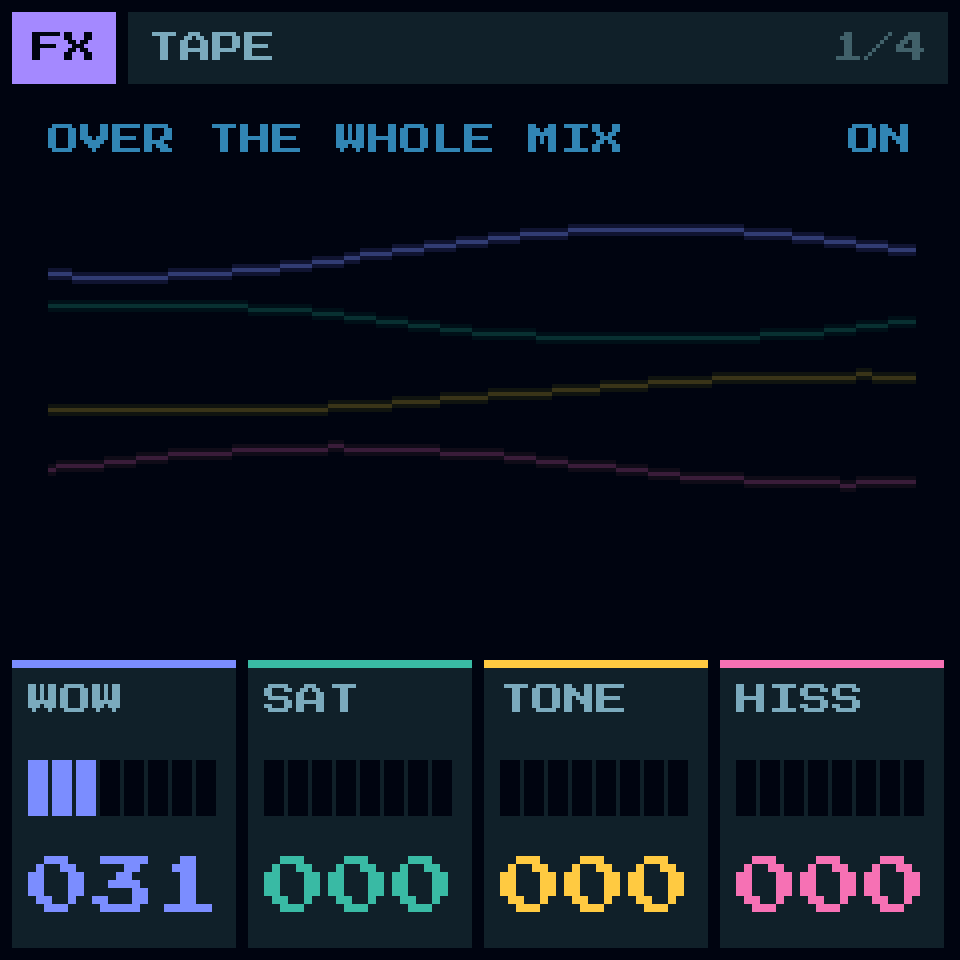 TAPE" width="320"> | 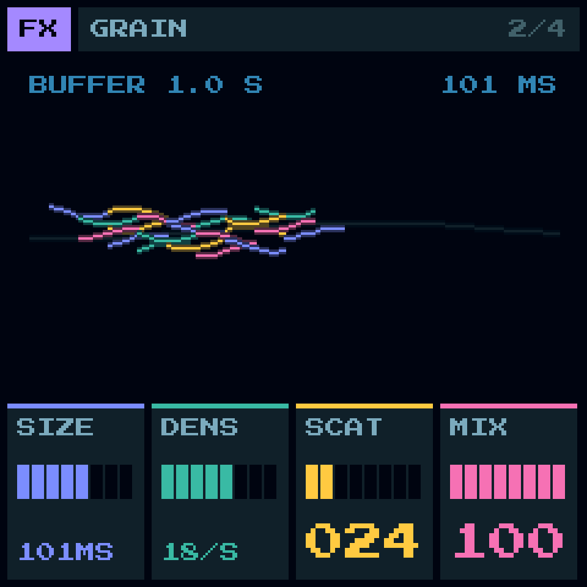 GRAIN" width="320"> |
| **DELAY** | **SPACE** |
| 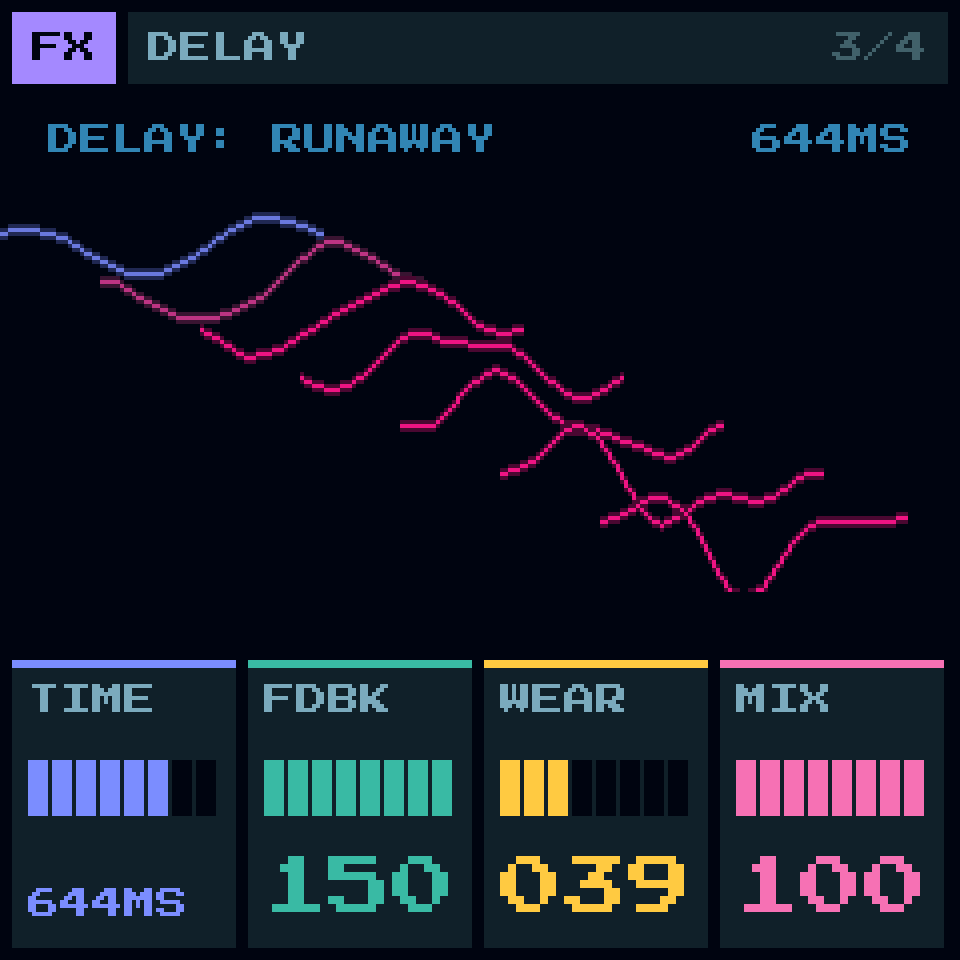 DELAY: runaway" width="320"> | 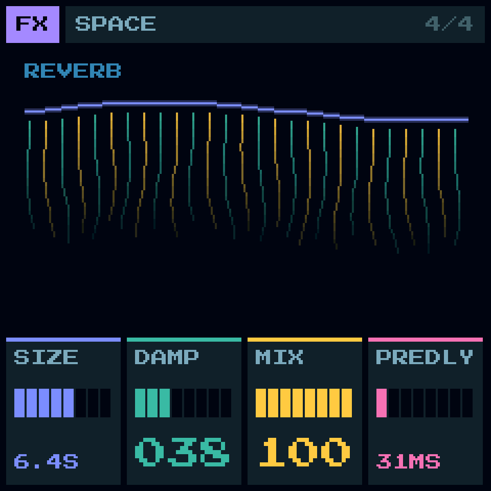 SPACE" width="320"> |

| Page | KNOB 1 | KNOB 2 | KNOB 3 | KNOB 4 |
|---|---|---|---|---|
| TAPE | WOW | SATURATION | TONE | HISS |
| GRAIN | SIZE (10–390 ms) | DENSITY | SCATTER | MIX |
| DELAY | TIME (20 ms – 3 s) | FEEDBACK (to 150 %) | WEAR | MIX |
| SPACE | SIZE (to ~32 s, then INF) | DAMP | MIX | PRE-DELAY |

- **Runaway echo:** past 100 % FEEDBACK the echo grows and saturates, and burns magenta on the screen.
- GRAIN and DELAY both pour into SPACE. All four TAPE knobs at 0 switch TAPE off.

---

## 10 · Perform: hold FX

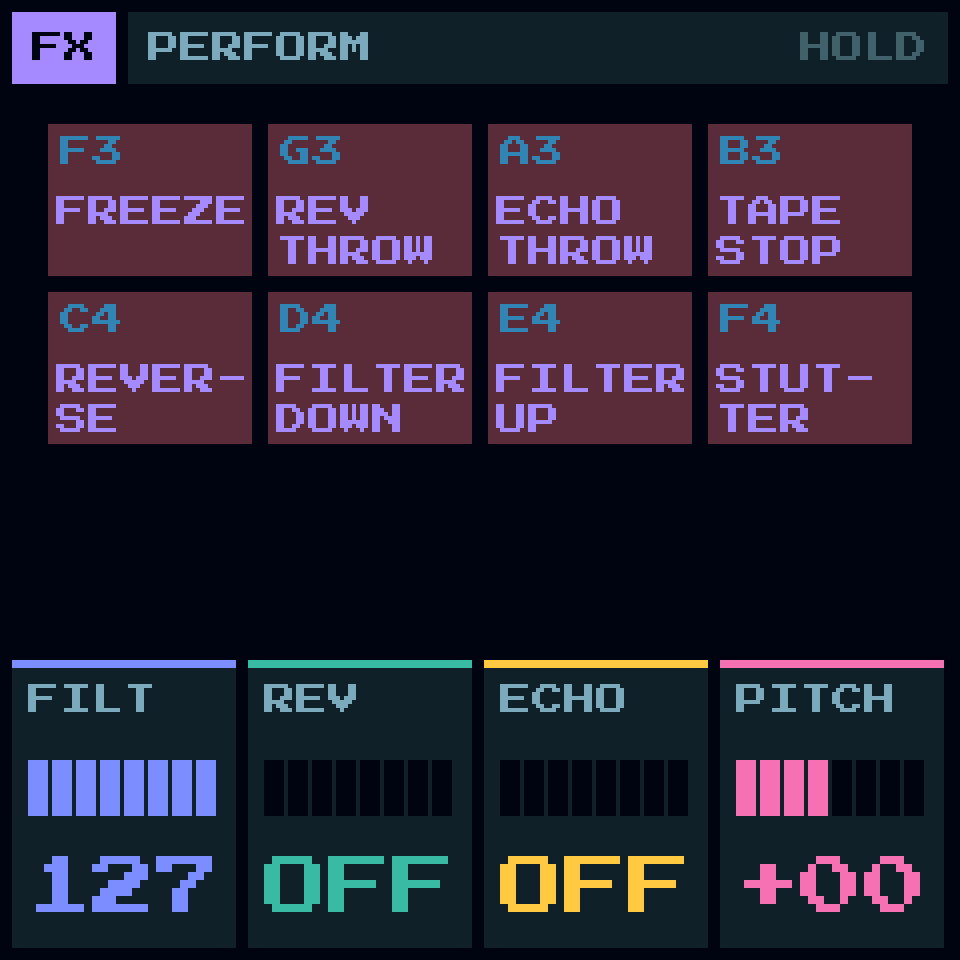

**Hold FX** for a moment and PERFORM appears. Each trick lasts while you hold its key; the sequencer keeps running,
and you land back in time when you let go.

| key 1 | key 2 | key 3 | key 4 |
|---|---|---|---|
| FREEZE | REV THROW | ECHO THROW | TAPE STOP |
| **key 5** | **key 6** | **key 7** | **key 8** |
| REVERSE | FILTER DOWN | FILTER UP | STUTTER |

FREEZE is a toggle: tap it to hold the grain cloud, tap again to let go.

 

---

## 11 · System: hold HOME

**Hold HOME** for **SYSTEM**; press HOME again for **SYSTEM 2**. These settings belong to the FM-1, not the project.

| SYSTEM | SYSTEM 2 |
|---|---|
| 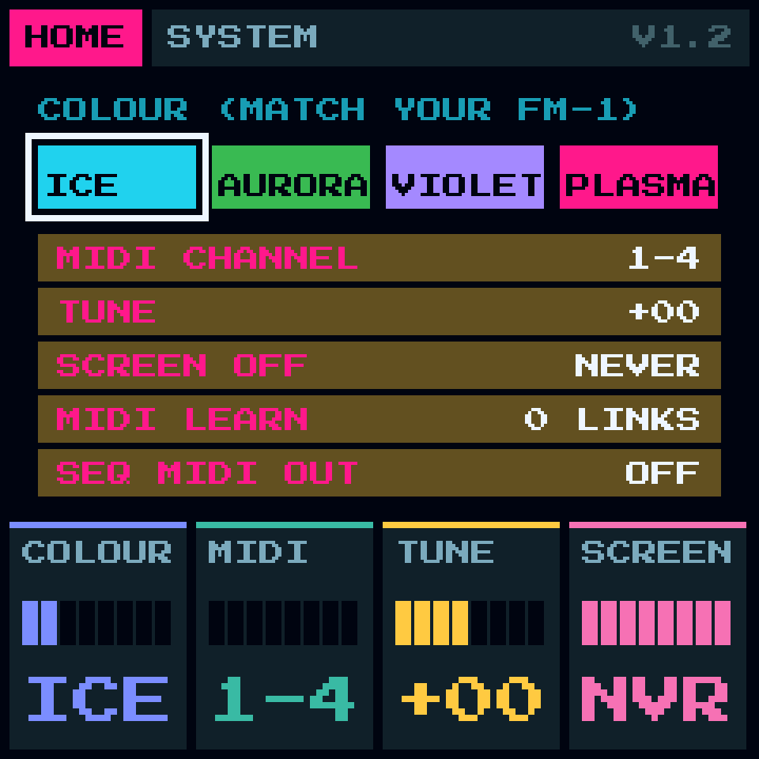 | 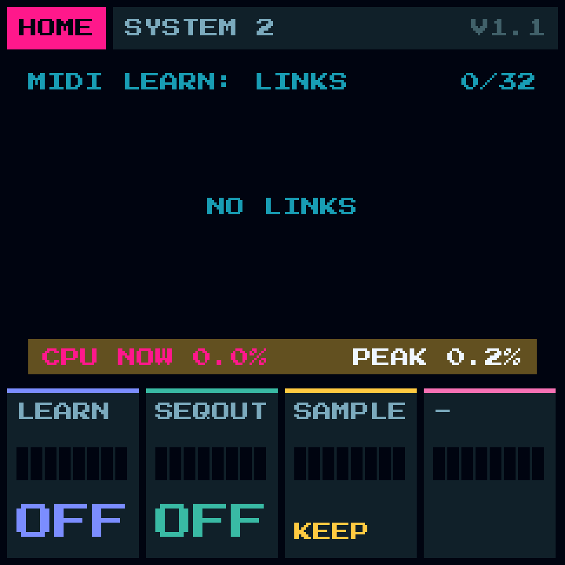 |

| Page | KNOB 1 | KNOB 2 | KNOB 3 | KNOB 4 |
|---|---|---|---|---|
| SYSTEM | COLOUR (ICE, AURORA, VIOLET, PLASMA) | MIDI CHANNEL | TUNE (±50 cents) | SCREEN OFF |
| SYSTEM 2 | MIDI LEARN | SEQ MIDI OUT | SAMPLES | |

- **COLOUR:** pick the one that matches your FM-1.
- **MIDI CHANNEL:** `1-4` puts T1–T4 on channels 1–4 (or higher, up to `13-16`); `ALL > SEL` sends everything to the
  selected track.
- **SCREEN OFF:** the screen goes dark after the chosen time; the music goes on. The first touch only wakes it.
- **MIDI LEARN:** set LEARN, turn a knob on the FM-1, then move one on your controller. Up to 32 links.
- **SEQ MIDI OUT:** sends the sequencer's and the arpeggiator's notes out over USB.
- **SAMPLES:** CLEAR and **OCT+** empties all four sample slots (stop and let the sound die out first).
- SYSTEM 2 shows the processor load, NOW and PEAK. OCT− + OCT+ together resets PEAK.

### USB audio

Over USB the FM-1 is also an audio input for your computer, phone or tablet: class compliant, so no driver,
16-bit stereo at 44.1 or 48 kHz (the computer picks). Choose the FM-1 as the input in your DAW and record. It is the
stereo mix with all its effects, as the speaker plays it, not each track apart; to record the tracks one by one, solo
each in turn (**hold GLO + keys 5–8**) and record a pass per track.

---

## 12 · Factory sounds

47 sounds with arctic names. Turn **PRESETS** to step through them by category, then your own.

| Category | Sounds |
|---|---|
| DRONE | Permafrost, Deep Fjord, Cracking Ice, Arctic Hum, Solar Wind, Under the Ice |
| DRONE · Holvut | Polar Howl, Wendigo, Frozen Scream, Whiteout, Dead Signal, III, **Ice Wraith** |
| PAD | Polar Night, Snow Veil, Glacier Pad, Midnight Sun, Lichen, Snowdrift |
| BELL | Ice Bell, Frost Chime, Iceberg Gong, Crystal Harp, Bowed Icicle, Starlight |
| VOICE | Aurora Choir, Tundra Voices, Blizzard Breath, Northern Call, Empty Horizon |
| ORGAN | Ice Organ, Base Camp |
| KEYS | Frost Keys, Snow Globe, Polar Keys, Ice Piano, Snow Owl, Signal Flare, Icicle Pluck, Frost Lute, Northern Light |
| OTHER | Tundra Strings, Icebreaker, Fog Horn, Svalbard Cello, North Strings |
| TEXTURE | Wind over Ice |

The seven Holvut sounds hold their notes (LATCH) and start with DRONE on.

---

## 13 · Combos at a glance

| Hold | + | Does |
|---|---|---|
| EDIT | OCT− / OCT+ | Undo / redo |
| FX | white keys 1–8 | PERFORM: FREEZE … STUTTER |
| SEL | (alone, let go) | Chord mode on / off |
| SEL | a knob (sequencer pages) | Lock that value to the step |
| SEL | OCT− (sequencer pages) | Clear the step's locks |
| SEQ | white keys 1–8 | Sequencer tools |
| SEQ | turn SELECT | Pattern length |
| SAVE | white keys 1–4 / 5–8 | Recall / save slots A–D |
| GLO | white keys 1–4 / 5–8 | Mute / solo T1–T4 |
| ARP | (alone) | Arpeggiator on / off |
| HOME | (alone) | SYSTEM |
| — | OCT− + OCT+ | Reset CPU PEAK |

---

## 14 · The editor and the demo

### The editor

**[polarpatch.github.io/Arctic-scream-FM-1/editor.html](https://polarpatch.github.io/Arctic-scream-FM-1/editor.html)**,
in Chrome or Edge on a computer. Connect the FM-1 over USB, press **CONNECT** and allow MIDI. Without an FM-1 the page
runs the firmware itself.

- **Sound:** every setting of the four tracks, live, with the instrument's screen and keys beside it. Undo and redo,
  compare, A/B and morph, randomize.
- **Sequencer:** a step grid, a piano roll or a typed list; MIDI files in and out.
- **Library:** the factory sounds and your 64 slots: load, name, store, import and export.
- **Samples:** WAVs into the four slots. **Backup:** everything in one file, and restore.

The FM-1 only writes to its memory while the sequencer is stopped and nothing sounds. If the editor asks you to stop
the sequencer while nothing plays, a latched note is still howling: set LATCH OFF, let it die out, then store.

### The demo

**[polarpatch.github.io/Arctic-scream-FM-1](https://polarpatch.github.io/Arctic-scream-FM-1/)**: the FM-1's panel in
your browser, running the same firmware, with five demos (A1–A5) to start from. Press **SWITCH ON**, then play with the
mouse or the computer keyboard.

| Key | Does |
|---|---|
| `Z X C V B N M , . /` | The white keys from F2 |
| `S D F H J L ; '` | The black keys |
| `Q W E R T Y U I O` | B3 to G4 |
| `1 2 3 4 5 6` | FX, SCL (SEL), ENV, LFO, EDIT, GLO |
| `7 8 9 0 - =` | HOME, SAVE, ARP, SEQ, PLAY, REC |
| `[` `]` | OCT−, OCT+ |
| `↑` `↓` | SELECT |
| `←` `→` | ALGORITHM (the track) |

Hold a button's key and press others for combos. With the mouse, right-click or Shift-click a button to keep it held.
Drag or scroll a knob to turn it.

---

**Stuck?** The Rescue page on the [FM-1 Firmware Hub](https://thefirmwarehub.com/) brings an FM-1 back.
Arctic Scream p0larpatch is free and open source (GPL-3.0); see the [README](README.md) for the credits.
