
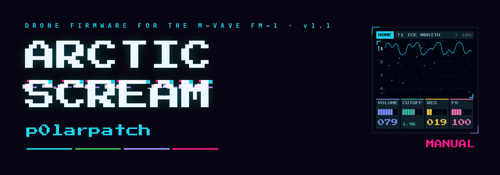

# Arctic Scream p0larpatch: the manual

**Version 1.5.1, for the M-VAVE FM-1.** Every picture here is the FM-1's own screen, taken from the firmware itself
(`tools/make_screens.py`).

> **Try it as you read:** the [demo](https://polarpatch.github.io/Arctic-scream-FM-1/) runs the same code in your
> browser. Every button and combo is also on one page in the
> [cheat sheet](https://polarpatch.github.io/Arctic-scream-FM-1/cheatsheet.html), and every page with its screen in the
> [visual manual](https://polarpatch.github.io/Arctic-scream-FM-1/manual.html) ([PDF](docs/manual/arctic-scream-manual.pdf)).

| | |
|---|---|
| [01 · The basics](#01--the-basics) | [07 · Sequencer](#07--sequencer-seq-play-rec) |
| [02 · HOME](#02--home) | [08 · Slots, sounds and songs](#08--slots-sounds-and-songs-save-glo) |
| [03 · Sources: EDIT](#03--sources-edit) | [09 · Destroy: FX](#09--destroy-fx) |
| [04 · DRONE](#04--drone-a-sound-that-lives-on-its-own) | [10 · Perform: hold FX](#10--perform-hold-fx) |
| [05 · ENV and LFO](#05--env-and-lfo) | [11 · System: hold HOME](#11--system-hold-home) |
| [06 · Scales, chords, arpeggiator](#06--scales-chords-and-the-arpeggiator-sel-arp) | [12 · Factory sounds](#12--factory-sounds) · [13 · Combos](#13--combos-at-a-glance) · [14 · Editor and demo](#14--the-editor-and-the-demo) |

---

## 01 · The basics

Arctic Scream has **four tracks, T1–T4**. Each track plays its own sound, has its own sequence and goes through the
shared effects. **Six voices** are shared by all four.

Every track starts with **ICE WRAITH**, a Holvut sound that holds its notes: press a low key and let it howl.

| Control | What it does |
|---|---|
| **ALGORITHM** | Picks the track (T1–T4). Every page shows that track. |
| **PRESETS** | Loads the next or previous sound into the track. On the sequencer pages: the tempo. |
| **SELECT** | On HOME: the tempo. On the sequencer: the cursor. |
| **KNOB 1–4** | The four values along the bottom of the screen, on every page. |
| **MASTER** | Volume. |
| **OCT− / OCT+** | Octave down and up. In save menus: back and confirm. |
| **Keys** | Play the track. The first white key is **F2**: everything sits an octave down, for drones. |

- **Pages:** tap a button for its first page, again for the next. The header shows where you are, e.g. `FX > DELAY`.
  Many buttons do more when **held** while you press a key or turn a knob (see [13 · Combos](#13--combos-at-a-glance)).
- **Knobs speed up:** turn slowly for fine steps, fast to sweep.
- **LATCH ON:** a key starts its note, the same key again stops it. **Hold SEL + OCT+** switches the selected track's
  LATCH on or off from any page (off lets go of all its latched notes). The keys of latched and arpeggiated notes stay
  lit, and their lights follow OCT− and OCT+.
- **Saving is automatic.** When the sequencer is stopped and everything is silent, your work saves itself, and it comes
  back at power-on as you left it. A latched drone never goes silent: the header says `SAVES WHEN SILENT`, and once you
  have left the FM-1 alone for 30 seconds it saves anyway (since 1.5), with a short gap in the sound.
- **Saves you ask for happen at once** (since 1.5): a slot saved with SAVE + keys 5–8 or on PROJECTS, a sound saved on
  SOUNDS. If something is sounding you hear a gap of about 50 ms. While the sequencer plays they wait for STOP.
- **Undo:** hold **EDIT** and press **OCT−**; **OCT+** redoes.

 

---

## 02 · HOME

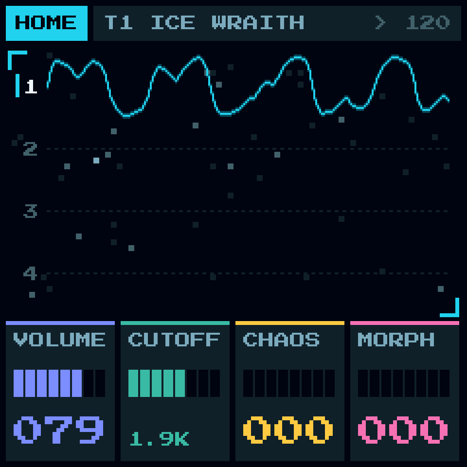

Each track's wave glows on HOME as it plays, under a starry sky. The header shows the track, its sound and the tempo.

| KNOB 1 | KNOB 2 | KNOB 3 | KNOB 4 |
|---|---|---|---|
| VOLUME | CUTOFF | WARP | MORPH |

- **CUTOFF:** the track filter at the end of the track, for every source (its RESONANCE is on MIXER 2).
- **WARP:** eight layers that come in one after another as you turn it, so the sound grows smoothly from still to wild: the voices drift apart like a choir; the filter breathes open; the source's knobs wander; the source is pushed the way DRONE's storm pushes it; a slow vibrato; more resonance and wider sweeps; the voices pull far apart and wander faster; at the top a tape's flutter and a sagging pitch. Nothing jumps and nothing goes silent.
- **MORPH:** one knob through all four of the source's knobs at once (on PHYS: STRUCTURE, DAMP and BOW; the stepped ones, such as MODEL, stay as set), on a path of its own for each track and source, always the same, with a slow wandering around it that grows as you turn it up. At 0 the sound is as set.
- While WARP or MORPH is up, the track's level is held where it was, so neither makes it suddenly louder or quieter; both sit on top of the knobs (the knobs themselves never move) and are saved with the project.

Press **HOME** again for the mixers. MIXER 1 draws each track as a curtain of standing ribbons, MIXER 2 as a ribbon
across the stereo field.

| Page | KNOB 1 | KNOB 2 | KNOB 3 | KNOB 4 |
|---|---|---|---|---|
| MIXER 1 | LEVEL | DLY SEND | REV SEND | GRAIN SEND |
| MIXER 2 | PAN | TYPE | POS | RESONANCE |

- **TYPE** (MIXER 2): the track filter is a low-pass (`LP`), high-pass (`HP`) or band-pass (`BP`). `LP` open (CUTOFF at the top) or `HP` open (CUTOFF at the bottom) means no filtering. A band-pass is gentle at RESONANCE 0 and narrows as you turn it up.
- **POS** (MIXER 2): `PRE`: the effect sends hear the filtered sound (as before 1.3). `POST`: only the track's dry sound is filtered; GRAIN, DELAY and SPACE hear it unfiltered (a dark track with a bright reverb, say).

 

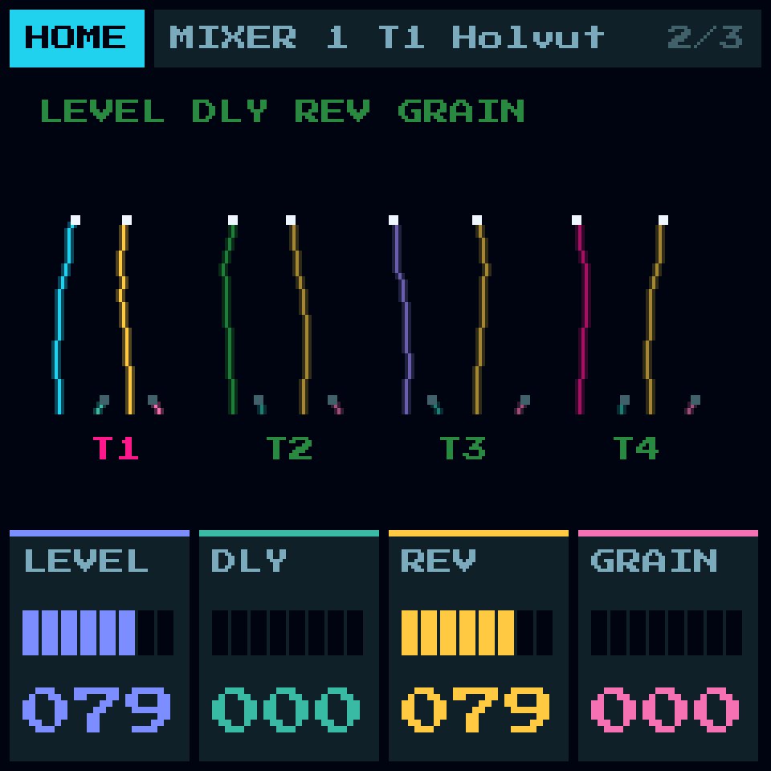

---

## 03 · Sources: EDIT

**EDIT** opens the track's **SOUND** page (the source's four knobs), then **SOURCE**. An FM track has two more pages
(FM ALGO, FM OP), and a Holvut track one: **LOOP**, between SOUND and SOURCE.

| SOUND: Holvut | SOURCE |
|---|---|
| 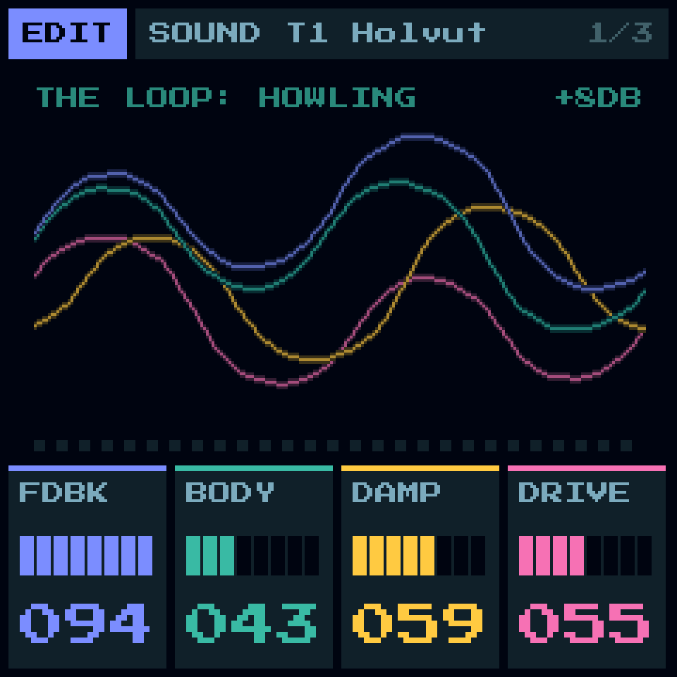 | 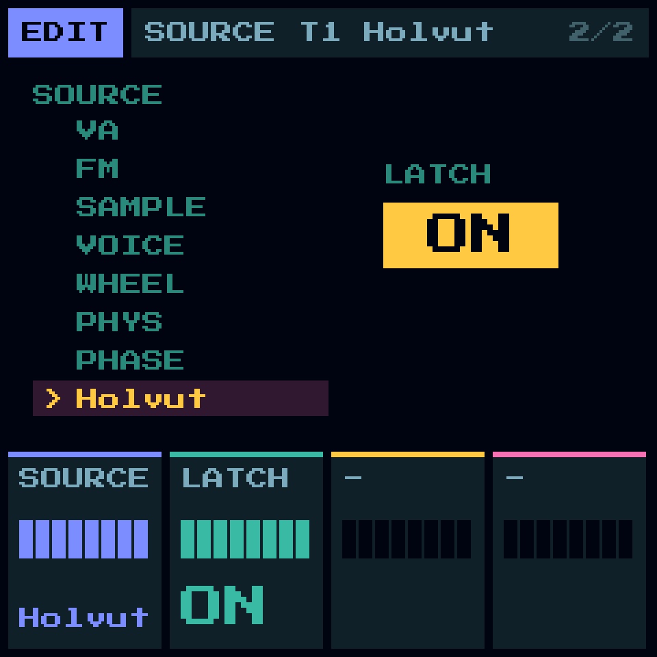 |

**SOURCE:** KNOB 1 picks the source, KNOB 2 sets LATCH.

| Source | KNOB 1 | KNOB 2 | KNOB 3 | KNOB 4 | What it is |
|---|---|---|---|---|---|
| **Holvut** | FEEDBACK | BODY | DAMP | DRIVE | A feedback loop that howls by itself |
| **VA** | WAVE | DETUNE | CUTOFF | RESONANCE | Virtual analog: saw, square, supersaw |
| **FM** | PATCH | BRIGHT | DECAY | DETUNE | Six operators, 32 algorithms, its own patch |
| **SAMPLE** | SLOT | START | LENGTH | REVERSE | Your own WAVs in four slots, played as a loop |
| **VOICE** | VOWEL | SHIFT | BUZZ | BREATH | A singing formant voice |
| **WHEEL** | DRAWBARS | PERC | CLICK | DRIVE | A tonewheel organ |
| **PHYS** | MODEL | STRUCTURE | DAMP | BOW | Bowed and struck strings, bars, plates, membranes |
| **PHASE** | WAVE | WAVE2 | DCW | DETUNE | Phase distortion |

### Holvut, the feedback voice

*Holvut* is North Sami for "to howl". A string and a resonant body sit inside a loop with saturation, filters and
diffusion. Nothing is struck.

- **Below the threshold the loop sleeps.** Past it, at about two thirds of FEEDBACK, it wakes, grows out of silence
  and howls by itself. The screen says `THE LOOP: ASLEEP` or `HOWLING`.
- **Each key sends a burst into the loop**, so a note played near the threshold sets it off.
- **FEEDBACK** wakes it, **BODY** bends it, **DAMP** turns the scream into a growl, **DRIVE** tears it.
- **BODY** runs from ~1 to ~92 ms. Past 100 it goes faster, to slow, beating howls, and past 115 to slow pulses.
- **Overblow:** turn **FEEDBACK** all the way up (its last steps, 120–127) and the howl leaps up the note's overtones
  and screams higher.
- **Pressure:** play from a MIDI keyboard with aftertouch and press harder: the note feeds back more, then overblows.
  Ease off and it falls back.
- Its four aurora ribbons move with the knobs.
- **III** is a horrorscape: three Holvut voices in a CLUSTER chord, a semitone rubbing in it, dark and slowly waking.
  Hold a key around C4. Turn **DAMP** down to let it scream, **BODY** to bend it, **FEEDBACK** to wake or calm it.
  Step by step: [how to play III](docs/iii/iii_en.md).

### Holvut's LOOP page (new in 1.4)

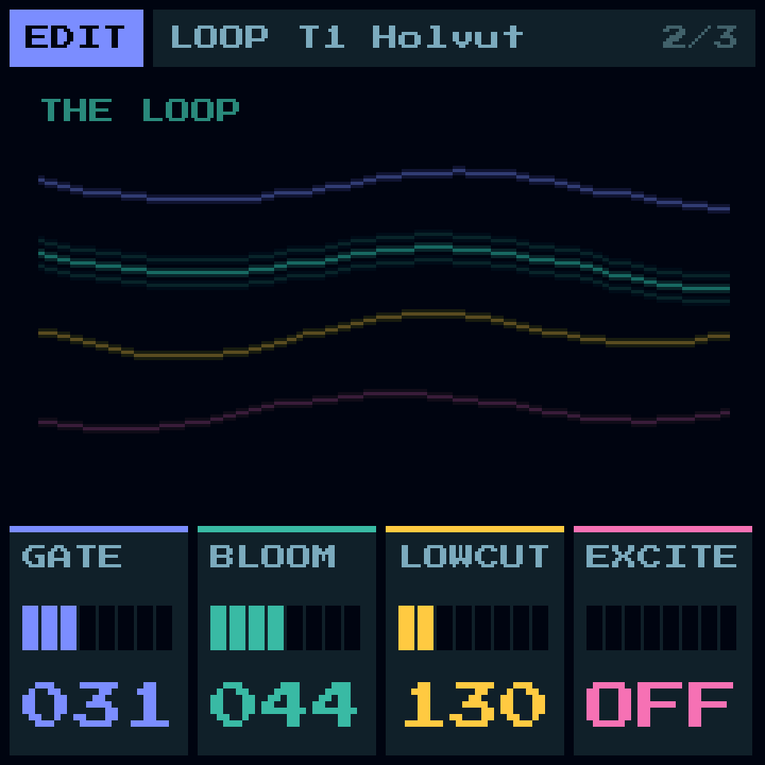

Press **EDIT** again on a Holvut track: **SOUND → LOOP → SOURCE**. Four knobs on the loop itself; all four at `OFF` (0)
sound as before 1.4. They are saved with the sound and the project.

| KNOB 1 | KNOB 2 | KNOB 3 | KNOB 4 |
|---|---|---|---|
| GATE | BLOOM | LOWCUT (~70 Hz – ~1.9 kHz) | EXCITE |

- **GATE:** when you let go of the key, the loop stops feeding itself. All the way up it dies into its own tail; in
  between it fades but lingers. At `OFF` the howl goes on through the release as before.
- **BLOOM:** what GRAIN, DELAY and SPACE add to the mix goes back into the loop: an FX loop inside the feedback. Turn up
  a track's sends and the scream grows inside its own echoes and reverb.
- **LOWCUT:** a high-pass inside the loop. The howl thins and climbs; with DAMP it leaves a band that screams.
- **EXCITE:** the track's sample (SAMPLE's SLOT, START and LENGTH, looped) is fed into the string, so your own sound
  wakes and colours the howl. The slab shows the slot, `S2 45%`, or `EMPTY` when that slot has no sample. Set it on
  the SAMPLE source first, then switch the track back to Holvut.
- Each knob is a ribbon on the screen: GATE's tail fades out, BLOOM's echoes appear around it, LOWCUT takes the slow
  swell out of its ribbon, EXCITE throws sparks along it.

 

### The other sources

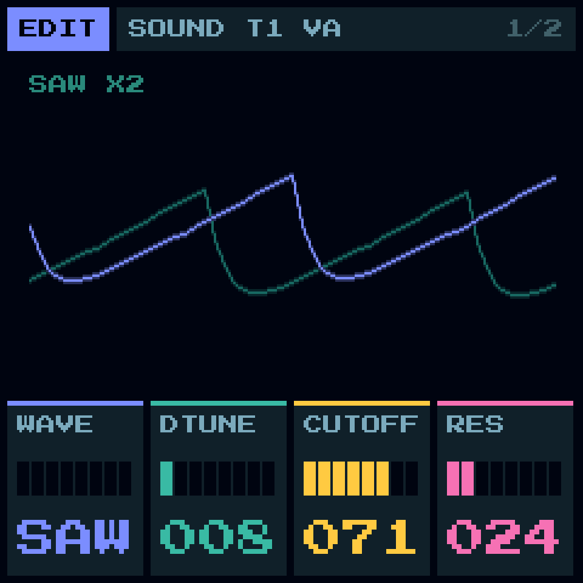

- **SAMPLE:** the four slots are yours: load WAVs from the [editor](#14--the-editor-and-the-demo). An empty slot is
  silent. No samples are built in, and samples already on your FM-1 stay.
- **PHYS:** STRUCTURE and BOW change meaning with the model; the screen shows the current name.

 

**FM tracks:** EDIT steps **SOUND → FM ALGO → FM OP → SOURCE**. The screen draws how the six operators are wired:
carriers (the ones you hear) outlined, modulators filled, the selected one lit.

| Page | KNOB 1 | KNOB 2 | KNOB 3 | KNOB 4 |
|---|---|---|---|---|
| FM ALGO | ALGO (1–32) | FEEDBACK | OP (1–6) | FINE |
| FM OP | RATIO | LEVEL | ATTACK | DECAY |

| FM ALGO | FM OP |
|---|---|
| 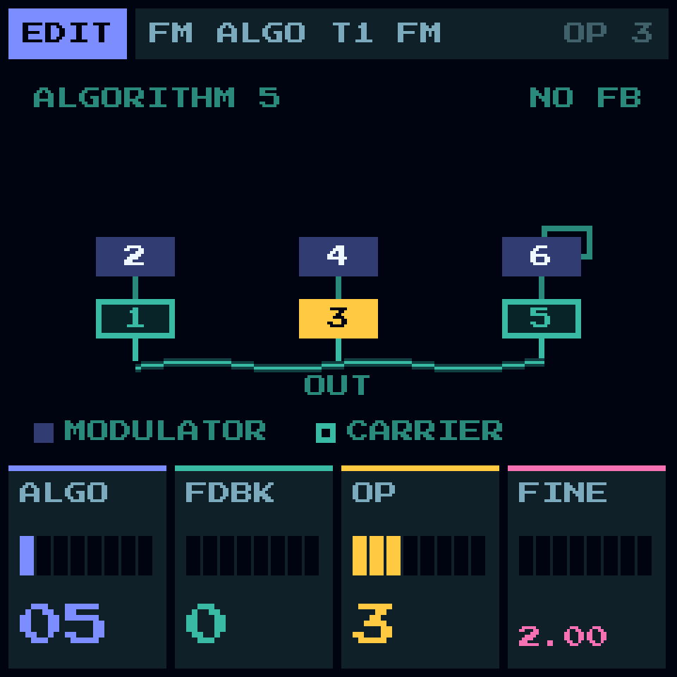 | 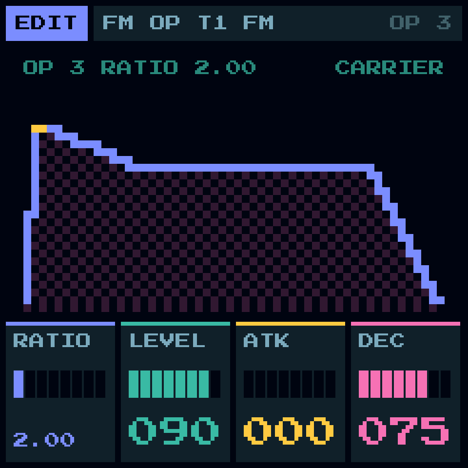 |

---

## 04 · DRONE: a sound that lives on its own

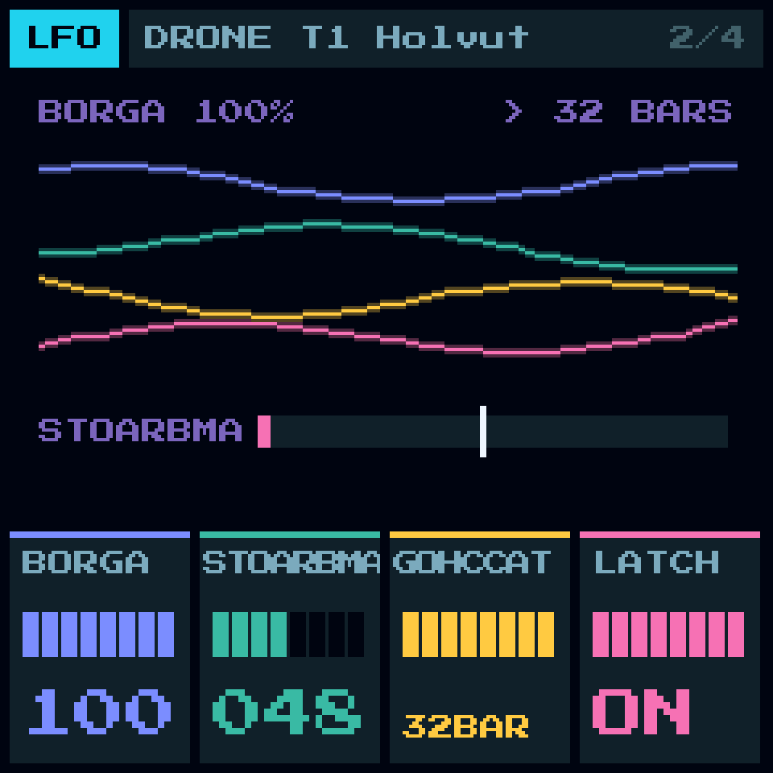

**Press LFO twice.** DRONE makes a held sound move by itself, slowly, and never the same way twice. The knobs have
North Sami names.

| KNOB 1 | KNOB 2 | KNOB 3 | KNOB 4 |
|---|---|---|---|
| **BORGA** (snowdrift) | **STOARBMA** (storm) | **GOHCCÁT** (to wake) | LATCH |

- **BORGA, 0–100 %:** four slow random walks move the filter, the source's shape, its most natural knob (on Holvut:
  FEEDBACK, around the threshold) and the reverb's distance. Each voice drifts a few cents and breathes, so a held
  chord sounds like a choir.
- **STOARBMA, 0–100 %:** the tension. It opens the filter, raises resonance and drive, spreads the voices and makes the
  walks deeper and faster.
- **GOHCCÁT, OFF or 1–32 bars:** how long the storm takes to rise, in tempo. A drone woken from silence starts calm
  and builds.
- **At 0 % nothing is added.** The settings are saved with the sound. The seven Holvut presets start with BORGA on.
- The screen draws the four walks as aurora ribbons and the storm as a bar with its target.

 

---

## 05 · ENV and LFO

| ENV | LFO |
|---|---|
| 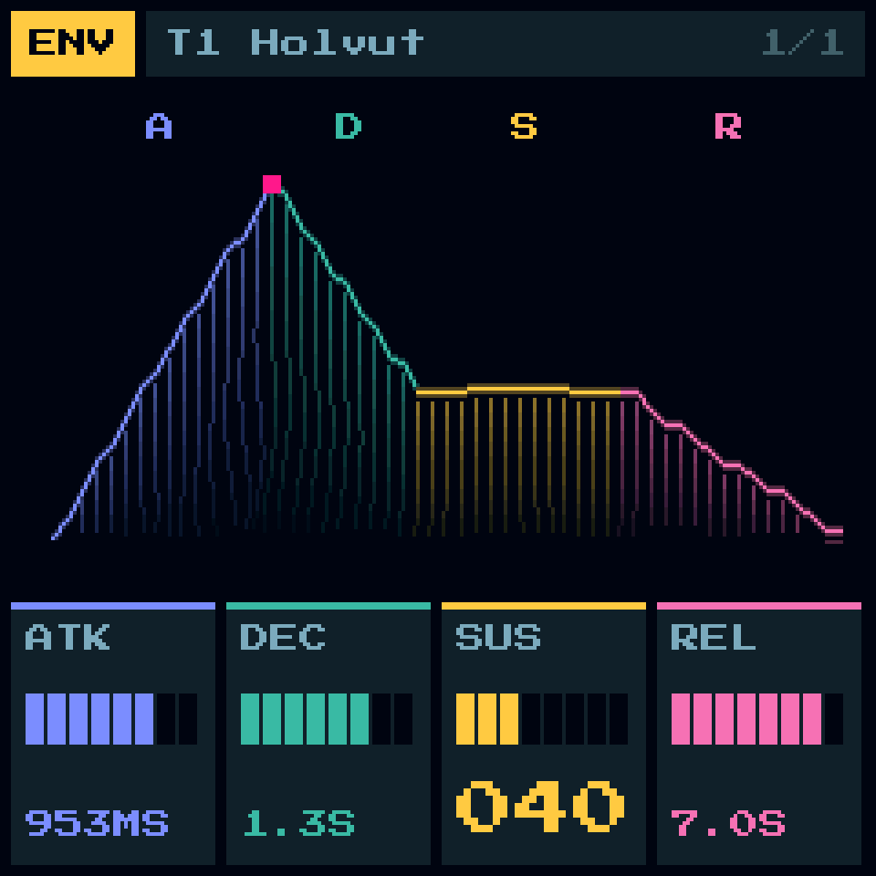 | 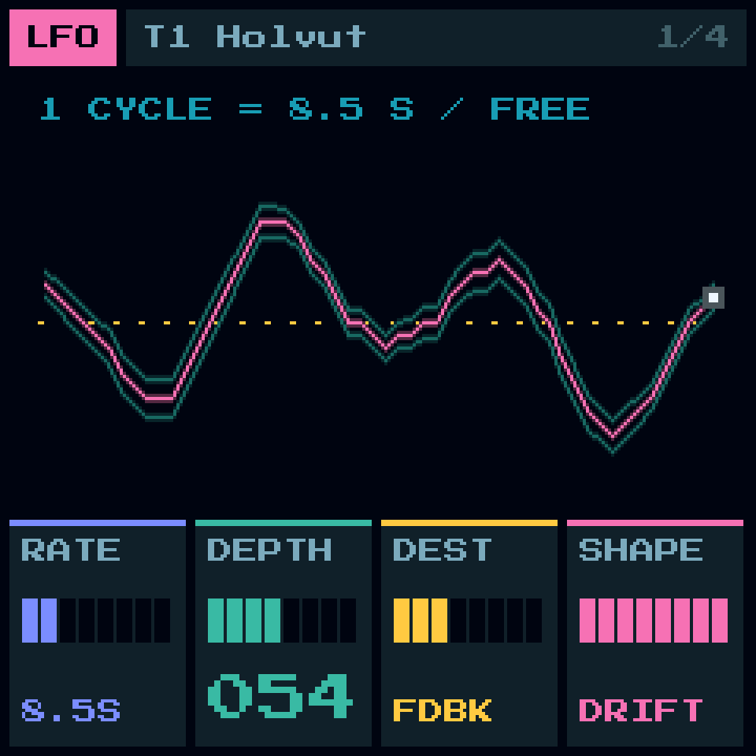 |

**ENV** (per track): how each note starts and ends. The envelope hangs as a curtain, each stage in its colour.

| KNOB 1 | KNOB 2 | KNOB 3 | KNOB 4 |
|---|---|---|---|
| ATTACK (~1 ms – 10 s) | DECAY (~10 ms – 10 s) | SUSTAIN (40 % to start) | RELEASE (~10 ms – 20 s) |

**LFO** (per track): slow movement. It never restarts with a note, so drones keep breathing.

| KNOB 1 | KNOB 2 | KNOB 3 | KNOB 4 |
|---|---|---|---|
| RATE (60 s a cycle – 20 Hz) | DEPTH (0 = off) | DESTINATION | SHAPE |

- **Destinations:** PITCH, VOLUME, PAN, the source's four knobs by name, REV SEND, GRAIN SEND, the track's CUTOFF.
- **Shapes:** SINE, TRIANGLE, SAW UP, SAW DOWN, SQUARE, RANDOM, DRIFT.
- **VOLUME swings around the track's VOLUME**, so a track at VOLUME 0 still sounds on the LFO's peaks. To silence a
  track, mute it (**hold GLO + keys 1–4**). A square wave on VOLUME at a fast RATE (~6 Hz) is a tremolo-picked guitar.

---

## 06 · Scales, chords and the arpeggiator: SEL, ARP

| SCALE | CHORD |
|---|---|
| 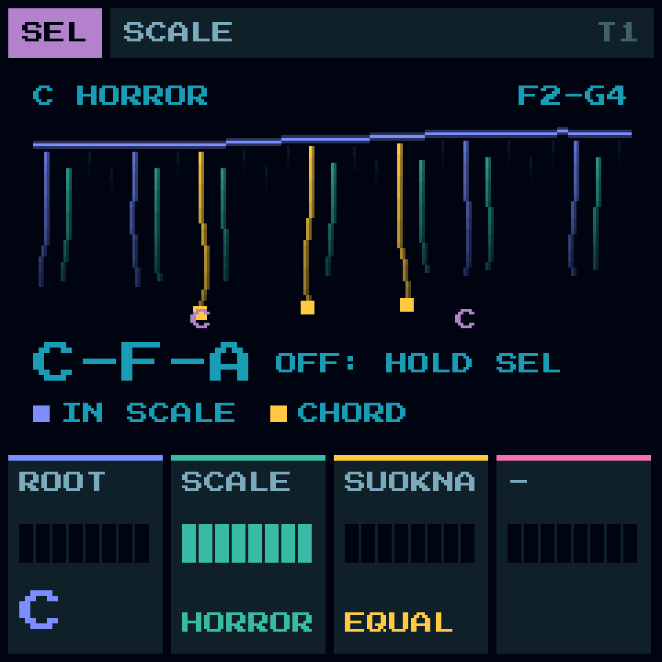 SCALE: C HORROR" width="320"> | 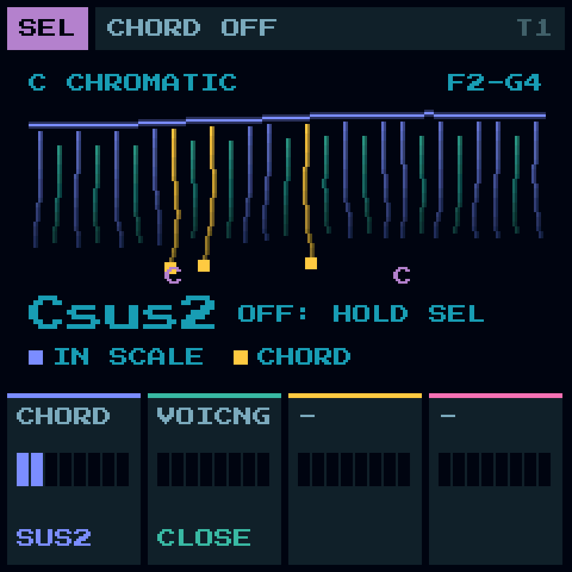 CHORD" width="320"> |

**SEL** opens **SCALE → CHORD**. **Hold SEL** (and let go) for chord mode on or off: one key, a whole chord.

| Page | KNOB 1 | KNOB 2 |
|---|---|---|
| SCALE | ROOT (C–B) | SCALE |
| CHORD | CHORD TYPE | VOICING |

- **SCALE**, shared by all tracks: OFF and fourteen scales, the last of them **HORROR**: close semitones, every note
  wrong in the right way. With a scale set, keys, MIDI and recordings snap to it.
- **CHORD TYPE:** SCALE (the scale's own chord), MIN, MAJ, SUS2, SUS4, FIFTH, MIN7, MAJ7, DIM, ADD9, CLUSTER.
- **VOICING:** CLOSE, OPEN, SPREAD, +OCT, DROP. Big chords use more of the six voices.

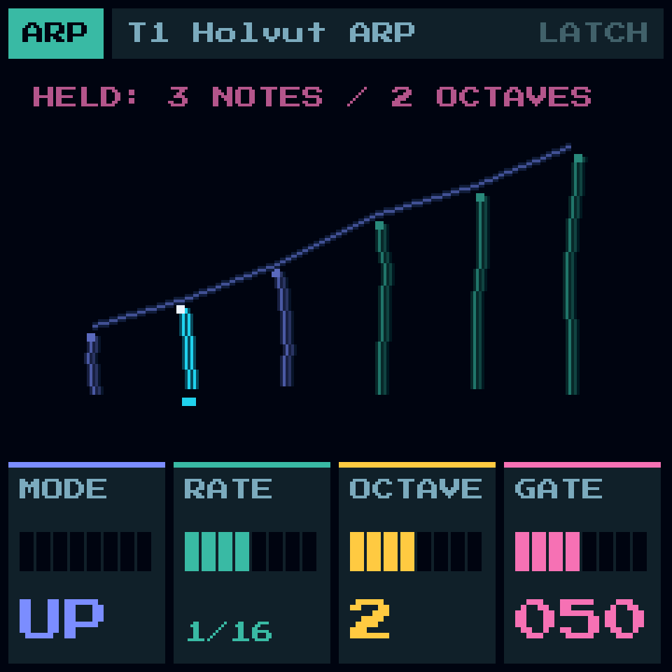

**ARP** opens the arpeggiator; **hold ARP** to switch it on or off for the track.

| KNOB 1 | KNOB 2 | KNOB 3 | KNOB 4 |
|---|---|---|---|
| MODE | RATE | OCTAVES (1–4) | GATE |

- **Modes:** UP, DOWN, UP-DOWN, RANDOM, AS PLAYED, CHORD. **Rates:** 1/1 to 1/32, and triplets.
- It plays the keys you hold. With LATCH ON it keeps going after you let go.
- It follows the sequencer's clock while it plays.

 

---

## 07 · Sequencer: SEQ, PLAY, REC

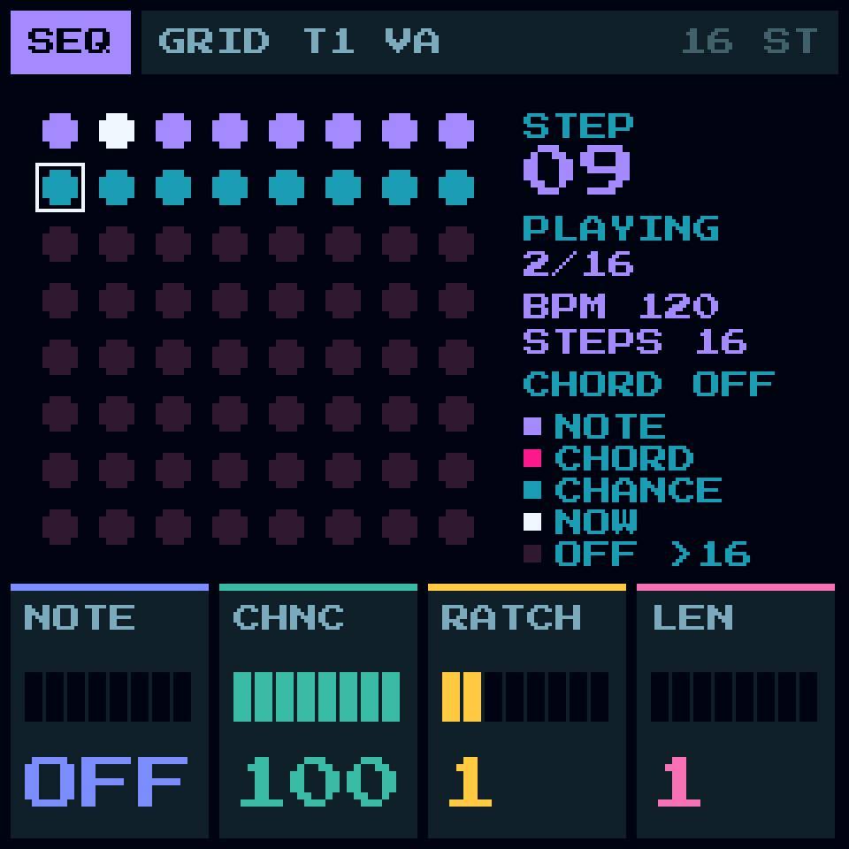 GRID: eight steps recorded, playing" width="360" align="right">

Each track has its own **64-step** pattern; all four play together on one tempo (20–300 BPM).
**SEQ** opens **GRID → PATTERN SETTINGS**, **PLAY/STOP** starts and stops, **REC** records.

**GRID**, the selected step:

| KNOB 1 | KNOB 2 | KNOB 3 | KNOB 4 |
|---|---|---|---|
| NOTE (all the way down = OFF) | CHANCE | RATCHET (1–4) | LENGTH |

**PATTERN SETTINGS:**

| KNOB 1 | KNOB 2 | KNOB 3 | KNOB 4 |
|---|---|---|---|
| STEPS (1–64) | DIVISION | SWING | PLAY MODE |

 

- **SELECT** moves the cursor; **hold SEQ + turn SELECT** sets the length. **PRESETS** sets the tempo.
- **Stopped + REC:** each key fills a step and moves on. **Playing + REC:** notes land on the nearest step.
- **Step locks:** hold **SEL** and turn a knob to lock that value to the step. **SEL + OCT−** clears them.
- **Hold REC ~1 s:** clears the selected track's pattern (undoable).
- **Hold SEQ + a white key** (all undoable):

| key 1 | key 2 | key 3 | key 4 | key 5 | key 6 | key 7 | key 8 |
|---|---|---|---|---|---|---|---|
| CLEAR | RANDOM | SHIFT ← | SHIFT → | COPY | PASTE | DOUBLE | MUTATE |

*(The white keys are counted from the left, from F2.)*

---

## 08 · Slots, sounds and songs: SAVE, GLO

### Slots A–D

A slot holds the four tracks' sounds, sequences, locks and mix.

- **Hold SAVE + keys 1–4:** recall A–D (at the next bar while playing). **Keys 5–8:** save into A–D; press again
  within 3 seconds to overwrite.
- **SAVE → PROJECTS:** SLOT and ACTION (LOAD, SAVE, ERASE, NEW), confirmed with **OCT+**.

### Your own sounds

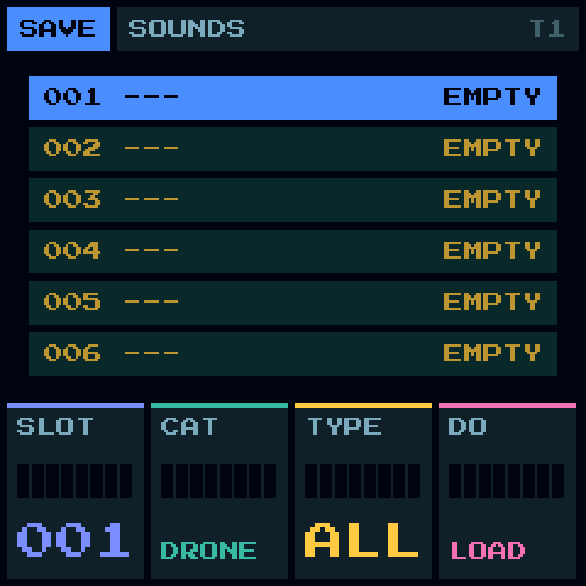 SOUNDS" width="300" align="right">

**SAVE → SOUNDS:** 64 slots for your own sounds. A sound keeps its source and knobs, ENV, LFO, DRONE, LATCH, chord
and (FM) its patch.

| KNOB 1 | KNOB 2 | KNOB 3 | KNOB 4 |
|---|---|---|---|
| SLOT | CATEGORY | TYPE | ACTION: LOAD / SAVE / CLEAR |

Confirm with **OCT+**, back out with **OCT−**. Saved sounds come in PRESETS after the factory sounds of their category.
Name them in the [editor](#14--the-editor-and-the-demo) (up to 10 characters).

 

### Songs: GLO

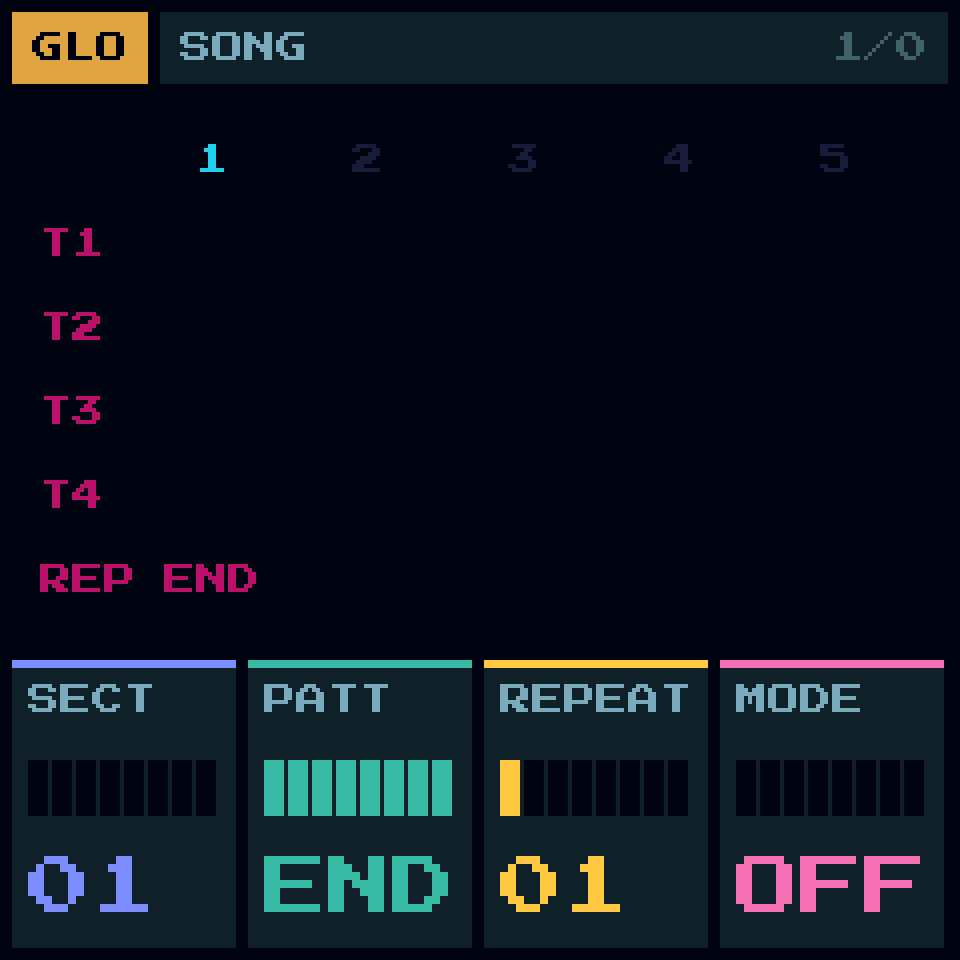 SONG" width="300" align="right">

**GLO** opens **SONG**: a chain of up to 16 steps, each a slot and its repeats.

| KNOB 1 | KNOB 2 | KNOB 3 | KNOB 4 |
|---|---|---|---|
| SECTION | PATTERN (A–D / END) | REPEATS (1–16) | MODE |

- **MODE:** OFF (PLAY loops the slot), SONG (once), SONG LOOP.
- **Record a song:** on SONG press **REC**, then **PLAY**, and switch slots with SAVE + keys 1–4.
- **Hold GLO + keys 1–4** mutes T1–T4, **keys 5–8** solos them.

 

Arctic Scream keeps its own saves, separate from other FM-1 firmwares.

---

## 09 · Destroy: FX

**FX** steps through **TAPE → GRAIN → DELAY → SPACE → MASTER → DRIVE → AIR**. Tracks feed GRAIN, DELAY and SPACE through their sends; TAPE
colours the whole mix at the end. Each page has its own northern lights.

| TAPE | GRAIN |
|---|---|
| 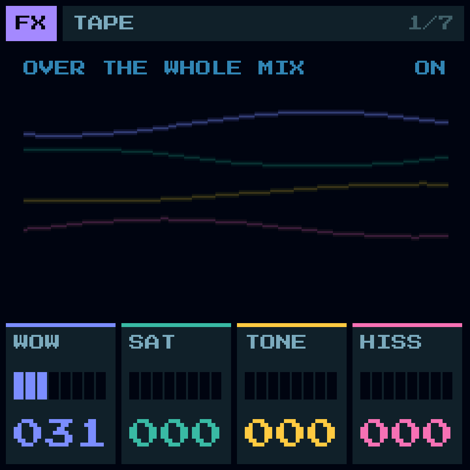 TAPE" width="320"> | 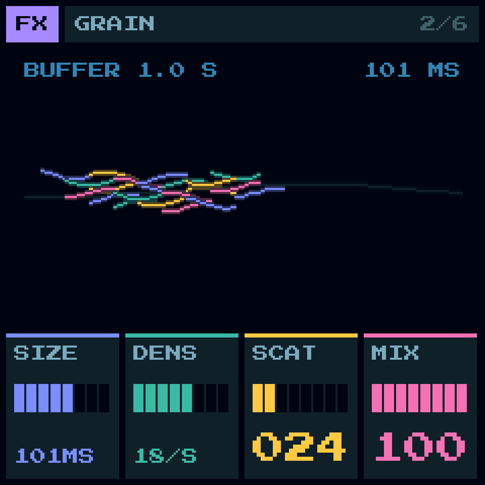 GRAIN" width="320"> |
| **DELAY** | **SPACE** |
| 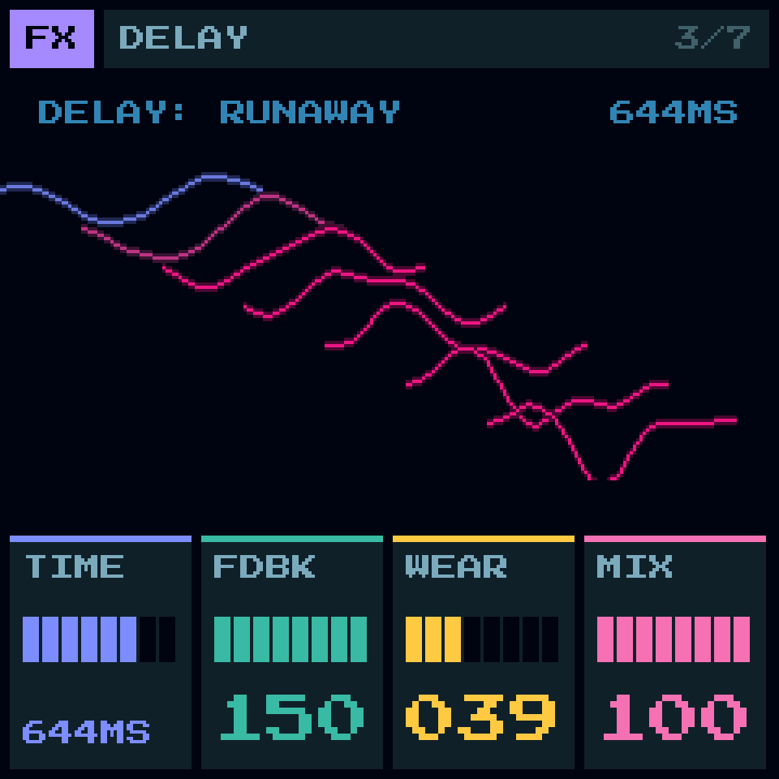 DELAY: runaway" width="320"> | 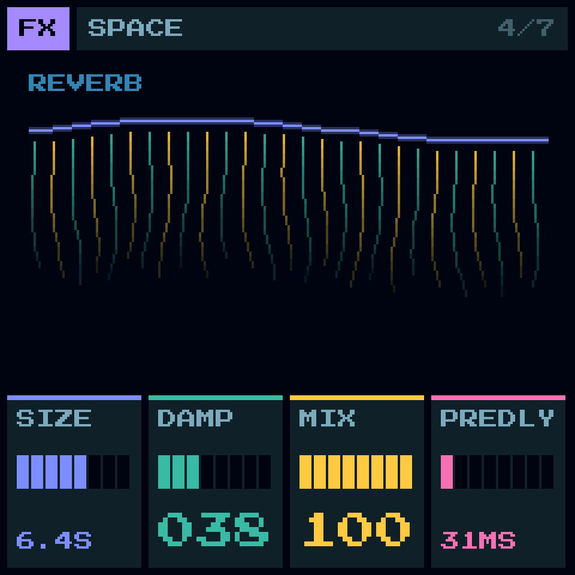 SPACE" width="320"> |

| Page | KNOB 1 | KNOB 2 | KNOB 3 | KNOB 4 |
|---|---|---|---|---|
| TAPE | WOW | SATURATION | TONE | HISS |
| GRAIN | SIZE (10–390 ms) | DENSITY | SCATTER | MIX |
| DELAY | TIME (20 ms – 2.6 s) | FEEDBACK (to 150 %) | WEAR | MIX |
| SPACE | SIZE (to ~32 s, then INF) | DAMP | MIX | PRE-DELAY |
| MASTER | CUTOFF | RESONANCE | TYPE (LP / HP / BP) | POSITION (PRE FX / POST REVERB / END) |
| DRIVE | AMOUNT | TYPE (SOFT / FUZZ / CLIP / FOLD) | TONE | MIX |
| AIR | PING (PING-PONG) | SHIMMR (SHIMMER) | | |

- **Runaway echo:** past 100 % FEEDBACK the echo grows and saturates, and burns magenta on the screen.
- GRAIN and DELAY both pour into SPACE. All four TAPE knobs at 0 switch TAPE off.
- GRAIN and DELAY only hear what the tracks send them (MIXER 1). Turn a GRAIN or DELAY knob up while the selected track sends nothing, and its send goes to 50 % (the header says so), so you hear the page at once.
- TAPE goes far: WOW to a seasick ±2 % of pitch, SATURATION to 12x drive, TONE darker as it turns up, from `OPEN` down to ~400 Hz (the screen shows its corner: `10K`, `2.4K`, `400`; the opposite way to DRIVE's TONE), HISS loud. DELAY's WEAR wobbles up to ~11 ms and drives the loop to 4x.

- **MASTER** filters everything, in stereo. **POSITION** says where: `PRE FX` filters the tracks' dry mix before the effects return (the reverb and echoes stay bright), `POST REVERB` filters the tracks and the effects together (before DRIVE and TAPE), `END` filters the very end, after TAPE and the PERFORM tricks. `LP` with CUTOFF at the top or `HP` at the bottom switches it off completely.
- **DRIVE** distorts everything after SPACE, before TAPE. **AMOUNT** is how hard (0 = off completely), **TYPE** the character: `SOFT` (warm saturation), `FUZZ` (lopsided, buzzy), `CLIP` (hard), `FOLD` (a wavefolder: the harder you drive it, the more it folds back into new overtones). All four are about equally loud at the same AMOUNT, so switching TYPE doesn't jump in volume, and turning AMOUNT all the way up makes it at most ~6 dB louder. **TONE** darkens it (`OPEN` at the top), **MIX** blends it with the clean sound. A limiter after it keeps even the loudest settings from blowing up the output.
- MASTER and DRIVE belong to the project (saved with it, like the other effects); TYPE and POS belong to each track.

### AIR (new in 1.4)

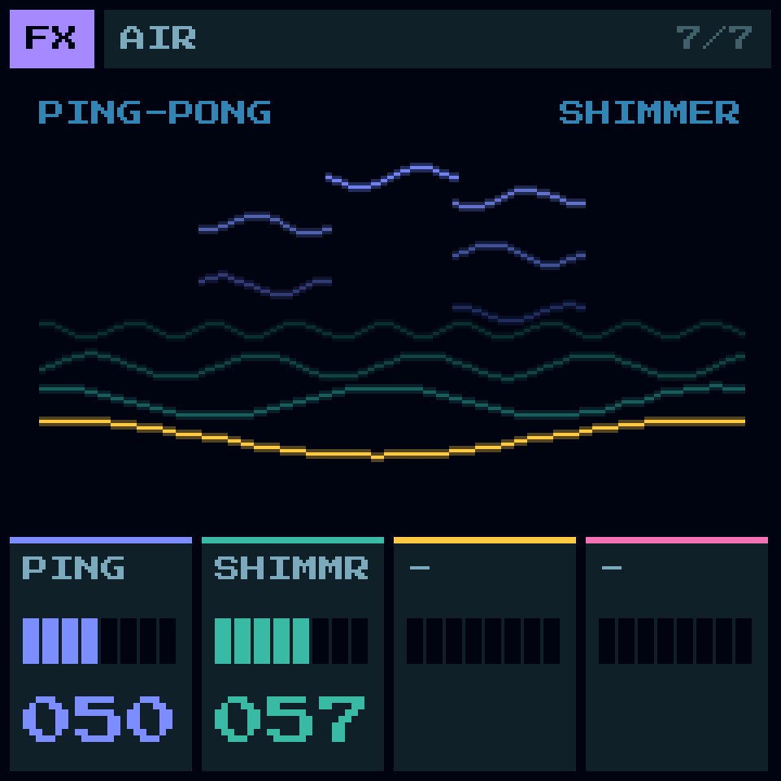 AIR: PING-PONG and SHIMMER" width="300" align="right">

- **PING-PONG** (KNOB 1) throws DELAY's echoes left, right, left, wider as you turn it up. The echoes come at the same
  TIME as before; while PING-PONG is on, TIME goes up to 1.3 s. At `OFF` DELAY is as it was.
- **SHIMMER** (KNOB 2) takes SPACE's tail an octave up and sends it back into the reverb, so the sound rises as it
  fades. Long SIZE and a high SHIMMER make a slow, bright choir out of any drone.
- On the screen, DELAY's echoes fly apart as PING-PONG grows, and SHIMMER's octaves rise over SPACE's tail.
- Both are saved with the project; projects from before 1.4 load with them off.

 

---

## 10 · Perform: hold FX

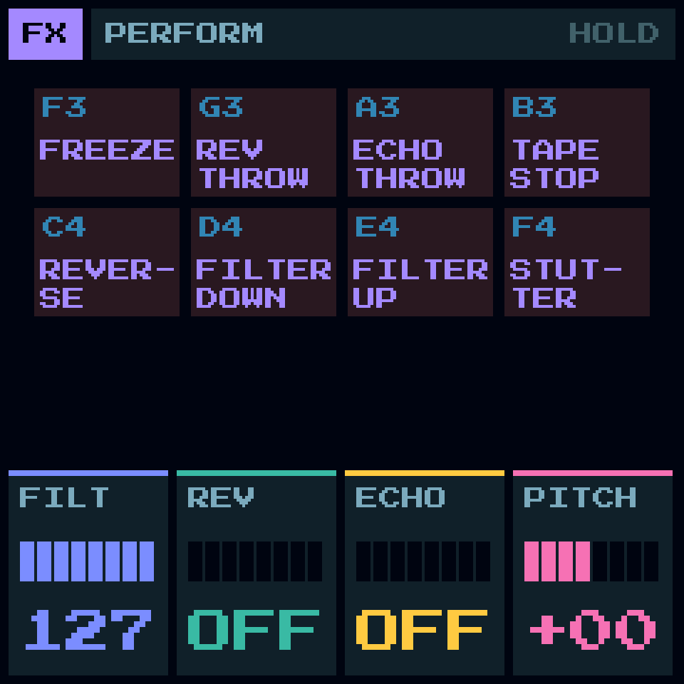

**Hold FX** for a moment and PERFORM appears. Each trick lasts while you hold its key; the sequencer keeps running,
and you land back in time when you let go.

| key 1 | key 2 | key 3 | key 4 |
|---|---|---|---|
| FREEZE | REV THROW | ECHO THROW | TAPE STOP |
| **key 5** | **key 6** | **key 7** | **key 8** |
| REVERSE | FILTER DOWN | FILTER UP | STUTTER |

FREEZE is a toggle: tap it to hold the grain cloud, tap again to let go.

 

### GENERATE: hold FX + a black key

A track can play by itself: random notes of the **SCALE** (with chord mode on: random chords, the track's chord on each), on the tempo (or the MIDI clock it follows, SYSTEM 2's CLOCK), whether the sequencer plays or not. It rests now and then and varies its note lengths, so it breathes, and every note gets a volume and an attack of its own. Each track has its own **MODE**, **OCTAVE** and **RANGE**.

| Hold FX + | F#2 | G#2 | A#2 | C#3 | D#3 | F#3 | G#3 | A#3 |
|---|---|---|---|---|---|---|---|---|
| | T1 | T2 | T3 | T4 | MODE | OCTAVE − | OCTAVE + | RANGE |

- **A track's key (F#2, G#2, A#2, C#3), tapped:** GENERATE on or off for that track. It switches when you let the key go, and only if you pressed no other key while holding it.
- **D#3, F#3, G#3, A#3 with a track's key held:** that track's MODE, OCTAVE or RANGE only (its on/off stays as it is). **Alone** (no track's key held): all four tracks together, all set to the same value (the next one after T1's).
- **MODE** steps through **DRIFT → PULSE → STORM**:
  - **DRIFT:** few notes, long (2–8 beats), soft, slow attacks: ambient.
  - **PULSE:** a melody on eighths, mostly on the beat, walking the scale in small steps: steadier.
  - **STORM:** dense, short sixteenths, the volume swinging wildly.
- **OCTAVE** (−3 … +3) is the generator's own, separate from the keyboard's OCT: at 0 its notes start at C3. **RANGE** (1, 2 or 3 OCT) is how far up from there it may play: OCTAVE 0 with RANGE 2 plays C3–B4; OCTAVE −1 takes it down among the drones.
- Every note stays in the SCALE and in the range. A chord's notes that would go past the range are folded back into it by whole octaves (they stay in the scale and the chord stays the same chord, voiced closer); two notes landing on the same pitch sound once.
- The header shows what changed for a moment: `T1 GENERATE PULSE`, `T1 GENERATE OFF`, `T2 PULSE`, `T1 OCT -1`, `ALL RANGE 2 OCT`.
- **The PERFORM screen** (FX held) shows a tile for each track under the tricks: lit while it generates, its MODE, its range (`C3-B4`), and a small square that flashes each time it plays a note.
- While FX is held, the eight black keys glow and the keys of the tracks that generate are lit.
- **The pattern:** while a track generates, its own pattern is not heard; it keeps running silently underneath, so when you switch GENERATE off it comes back in time, exactly as it was. GENERATE never writes into it.
- It plays the track's own sound through its own voices, like your keys: it never takes another track's voices (a full track skips a note). Mute and solo (GLO) work on it as usual.
- **Two or more tracks generating:** they share the six voices fairly. Each generating track gets an equal share of the voices the other tracks' keys, sequence and arp leave free (with all four generating: 2, 2, 1 and 1 voices for T1–T4), and a new note replaces that track's own oldest note (its fading tail) instead of cutting another track's. With chord mode on, a track plays as many of the chord's notes as its share holds, the root first. Keys, the sequencer and the arp keep the usual voice rules.
- **On a SAMPLE track** its notes can be much longer: from the mode's shortest up to the whole sample loop (the SOUND page's LENGTH), so you hear a sample play out instead of only its start. Other sources keep the mode's note lengths.
- Nothing is saved: after power-on GENERATE is off on every track, every track DRIFT, OCTAVE 0, RANGE 2 OCT.

---

## 11 · System: hold HOME

**Hold HOME** for **SYSTEM**; press HOME again for **SYSTEM 2**, again for **SYSTEM 3**. These settings belong to the
FM-1, not the project.

| SYSTEM | SYSTEM 2 |
|---|---|
| 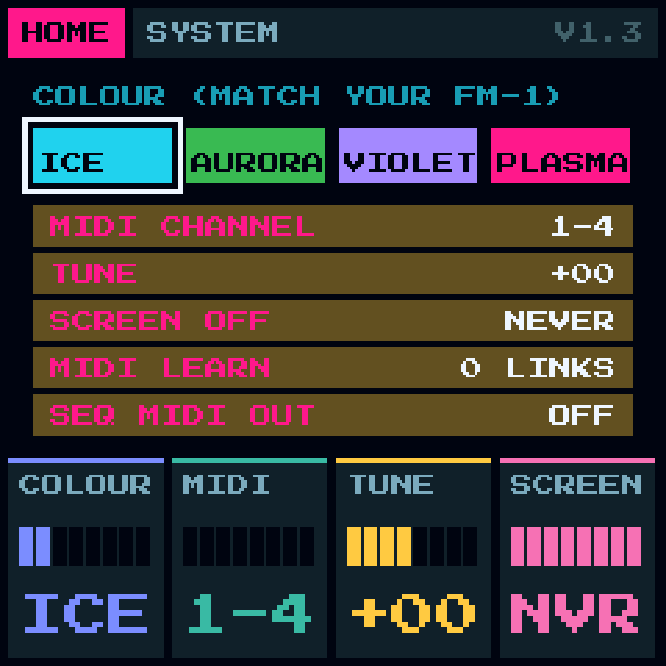 | 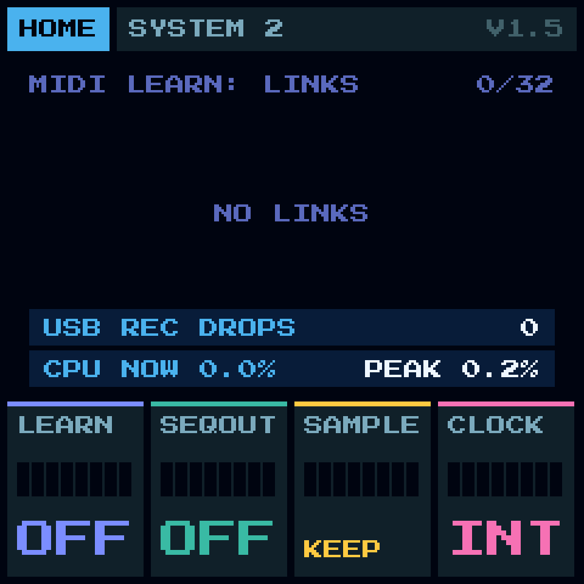 |

| Page | KNOB 1 | KNOB 2 | KNOB 3 | KNOB 4 |
|---|---|---|---|---|
| SYSTEM | COLOUR (ICE, AURORA, VIOLET, PLASMA) | MIDI CHANNEL | TUNE (±50 cents) | SCREEN OFF |
| SYSTEM 2 | MIDI LEARN | SEQ MIDI OUT | SAMPLES | CLOCK (INT, I+OUT, USB, TRS) |
| SYSTEM 3 | LATCH (FROM SOUND, ALWAYS OFF) | USB LEVEL (−12 to +24 dB) | | |

- **COLOUR:** pick the one that matches your FM-1.
- **MIDI CHANNEL:** `1-4` puts T1–T4 on channels 1–4 (or higher, up to `13-16`); `ALL > SEL` sends everything to the
  selected track; `CH 1 > SEL` … `CH 16 > SEL` sends only that channel to the selected track and ignores the others.
- **SCREEN OFF:** the screen goes dark after the chosen time; the music goes on. The first touch only wakes it.
- **MIDI LEARN:** set LEARN, turn a knob on the FM-1, then move one on your controller. Up to 32 links.
- **SEQ MIDI OUT:** sends the sequencer's and the arpeggiator's notes out over USB.
- **SAMPLES:** CLEAR and **OCT+** empties all four sample slots (stop and let the sound die out first).
- **CLOCK:** `INT`, the FM-1's own tempo. `I+OUT`, the same, and its MIDI clock out over USB (START, STOP and 24 pulses a
  beat) for a DAW or another instrument to follow. `USB` or `TRS`: the FM-1 follows a MIDI clock from there: START plays
  from step 1, CONTINUE from where STOP left it, STOP stops; HOME shows `EXT` and the tempo. Without pulses for half a
  second it goes on at its own tempo.
- **LATCH** (SYSTEM 3): `FROM SOUND`, a sound you load brings the LATCH it was saved with (the seven Holvut sounds latch).
  `ALWAYS OFF`, a sound you load sets the track's LATCH off; EDIT's LATCH and **SEL + OCT+** still switch it.
- **USB LEVEL** (SYSTEM 3, new in 1.4): how loud a computer records the FM-1, in 6 dB steps from −12 to +24 dB. `0 DB` is
  the volume knob all the way up; higher steps make quiet drones louder in the recording, and a limiter keeps them from
  clipping. The volume knob itself only sets the speaker and the headphones.
- SYSTEM 2 shows the processor load, NOW and PEAK, and over it **USB REC DROPS**: gaps in the sound sent to a computer
  over USB (stopping or pausing your DAW adds to it too). OCT− + OCT+ together sets both to 0.

### MIDI in

USB, or the 3.5 mm TRS jack with a TRS-to-DIN MIDI adapter (type A). Notes on MIDI CHANNEL's channels play the tracks as
their keys do, a CC its MIDI LEARN link, and the MIDI clock is followed when CLOCK says so. A DAW's ALL NOTES OFF lets
go of the notes MIDI holds (a latched note stays). Aftertouch pushes a Holvut track's FEEDBACK (see Holvut).

### Good to know

- **CPU FULL: NOTE DROPPED** in the header: the FM-1 had more to play than it can; it let go of a fading or a generated
  note first, your held and latched notes last.
- **WATCHDOG RESET** or **LOW VOLTAGE RESET** in the header after a start: why it restarted (the power dipped, or
  it stood still).
- A delay that feeds back for ever, SPACE on INF or a frozen GRAIN never fall silent: saves, sample uploads and the
  editor's writes go ahead 10 s after the last note anyway.
- **Headphones on wide, loud sound** (a big reverb, PING-PONG): the FM-1's headphone amplifier used to crackle. Since 1.4
  a limiter holds the difference between left and right in check near the top of MASTER; a mono sound never changes,
  and the USB recording is not touched.
- While a computer records the FM-1 over USB, it saves only after you have left it alone for a minute (a save stops
  the sound ~50 ms), and at once when the recording stops.
- **Newer FM-1s** (sold since autumn 2026) carry another flash chip, the UC25HQ80. Since 1.5.1 Arctic Scream saves and
  updates on it as on the first one. With 1.5 or older on such a unit the saves were gone after power-off and updates
  were refused: put 1.5.1 on once through the chip's download mode (the Firmware Hub's Rescue page, `#chip`).

### USB audio

Over USB the FM-1 is also an audio input for your computer, phone or tablet, and shows up there as **Arctic Scream**
(its MIDI port too): class compliant, so no driver,
16-bit stereo at 44.1 or 48 kHz (the computer picks). Choose the FM-1 as the input in your DAW and record. It is the
stereo mix with all its effects, not each track apart; to record the tracks one by one, solo each in turn (**hold GLO +
keys 5–8**) and record a pass per track. The computer gets the level SYSTEM 3's **USB LEVEL** sets (`0 DB`: the volume
knob all the way up; a limiter keeps it from clipping): the knob sets the speaker and the headphones, not the recording.
Since 1.3.1 it shows up on macOS 10.14 to 15 too.

---

## 12 · Factory sounds

47 sounds with arctic names. Turn **PRESETS** to step through them by category, then your own.

| Category | Sounds |
|---|---|
| DRONE | Permafrost, Deep Fjord, Cracking Ice, Arctic Hum, Solar Wind, Under the Ice |
| DRONE · Holvut | Polar Howl, Wendigo, Frozen Scream, Whiteout, Dead Signal, III, **Ice Wraith** |
| PAD | Polar Night, Snow Veil, Glacier Pad, Midnight Sun, Lichen, Snowdrift |
| BELL | Ice Bell, Frost Chime, Iceberg Gong, Crystal Harp, Bowed Icicle, Starlight |
| VOICE | Aurora Choir, Tundra Voices, Blizzard Breath, Northern Call, Empty Horizon |
| ORGAN | Ice Organ, Base Camp |
| KEYS | Frost Keys, Snow Globe, Polar Keys, Ice Piano, Snow Owl, Signal Flare, Icicle Pluck, Frost Lute, Northern Light |
| OTHER | Tundra Strings, Icebreaker, Fog Horn, Svalbard Cello, North Strings |
| TEXTURE | Wind over Ice |

The seven Holvut sounds hold their notes (LATCH) and start with DRONE on.

---

## 13 · Combos at a glance

| Hold | + | Does |
|---|---|---|
| EDIT | OCT− / OCT+ | Undo / redo |
| FX | white keys 1–8 | PERFORM: FREEZE … STUTTER |
| FX | black keys | GENERATE: T1–T4 on / off, MODE, OCTAVE, RANGE |
| SEL | (alone, let go) | Chord mode on / off |
| SEL | a knob (sequencer pages) | Lock that value to the step |
| SEL | OCT− (sequencer pages) | Clear the step's locks |
| SEL | OCT+ | The track's LATCH on / off |
| SEQ | white keys 1–8 | Sequencer tools |
| SEQ | turn SELECT | Pattern length |
| SAVE | white keys 1–4 / 5–8 | Recall / save slots A–D |
| GLO | white keys 1–4 / 5–8 | Mute / solo T1–T4 |
| ARP | (alone) | Arpeggiator on / off |
| REC | (alone, ~1 s) | Clear the track's pattern |
| HOME | (alone) | SYSTEM |
| — | OCT− + OCT+ | Reset CPU PEAK and USB REC DROPS |

---

## 14 · The editor and the demo

### The editor

**[polarpatch.github.io/Arctic-scream-FM-1/editor.html](https://polarpatch.github.io/Arctic-scream-FM-1/editor.html)**,
in Chrome or Edge on a computer. Connect the FM-1 over USB, press **CONNECT** and allow MIDI. Without an FM-1 the page
runs the firmware itself.

- **Sound:** every setting of the four tracks, live, with the instrument's screen and keys beside it. Undo and redo,
  compare, A/B and morph, randomize.
- **Sequencer:** a step grid, a piano roll or a typed list; MIDI files in and out.
- **Library:** the factory sounds and your 64 slots: load, name, store, import and export.
- **Samples:** WAVs into the four slots. **Backup:** everything in one file, the samples too, and restore.
  **Projects:** each slot A–D saved to a file of its own and loaded back, on a computer or an Android phone.
- **Settings:** MIDI CHANNEL, CLOCK and SYSTEM 3's LATCH, read and written.

The FM-1 only writes to its memory while the sequencer is stopped and nothing sounds. If the editor asks you to stop
the sequencer while nothing plays, a latched note is still howling: set LATCH OFF, let it die out, then store.

### The demo

**[polarpatch.github.io/Arctic-scream-FM-1](https://polarpatch.github.io/Arctic-scream-FM-1/)**: the FM-1's panel in
your browser, running the same firmware, with five demos (A1–A5) to start from. Press **SWITCH ON**, then play with the
mouse or the computer keyboard.

| Key | Does |
|---|---|
| `Z X C V B N M , . /` | The white keys from F2 |
| `S D F H J L ; '` | The black keys |
| `Q W E R T Y U I O` | B3 to G4 |
| `1 2 3 4 5 6` | FX, SCL (SEL), ENV, LFO, EDIT, GLO |
| `7 8 9 0 - =` | HOME, SAVE, ARP, SEQ, PLAY, REC |
| `[` `]` | OCT−, OCT+ |
| `↑` `↓` | SELECT |
| `←` `→` | ALGORITHM (the track) |

Hold a button's key and press others for combos. With the mouse, right-click or Shift-click a button to keep it held.
Drag or scroll a knob to turn it.

### The screen reader (new in 1.5)

Arctic Scream says what its screen shows, for blind and low-vision players. Connect the FM-1 over USB, open the
**[FM-1 Screen Reader](https://charlesvestal.github.io/fm1-reader/)** in Chrome or Edge and press **Connect**. The page
speaks with its own voice, or hands the words to your own screen reader (VoiceOver, NVDA, JAWS, TalkBack).

- **A new page** says its name, the track and its source, its place in its button's round and its four knobs:
  "loop, track 1 Holvut, page 2 of 3. gate off, bloom 45 percent, low cut 70 hertz, excite off".
- **A knob turned** says its name and value, once it settles: "feedback minus 4 decibels".
- **Lists** say the row and its place: on SAVE, "slot 5 drone 01, Holvut, 5 of 64"; on SEQ's grid, the step.
- **Messages** in the header are said at once: a sound's name from PRESETS, SAVED, LATCH ON. Warnings ("empty: not
  loaded", "C P U full: note dropped") are heard whole.
- **PLAY, STOP and REC** are said as they happen.
- The page's **Read the whole screen** button says everything on it, the picture's caption and the tempo too.

The FM-1 says nothing until the page asks, so a DAW on the same USB port never sees a byte of it. How each word on the
screen is said ("FDBK": feedback, "T1": track 1) lives in a small file on this project's site, not in the FM-1's
memory. The reader is made by Charles Vestal for many FM-1 firmwares.

---

**Stuck?** The Rescue page on the [FM-1 Firmware Hub](https://thefirmwarehub.com/) brings an FM-1 back.
Arctic Scream p0larpatch is free and open source (GPL-3.0); see the [README](README.md) for the credits.
