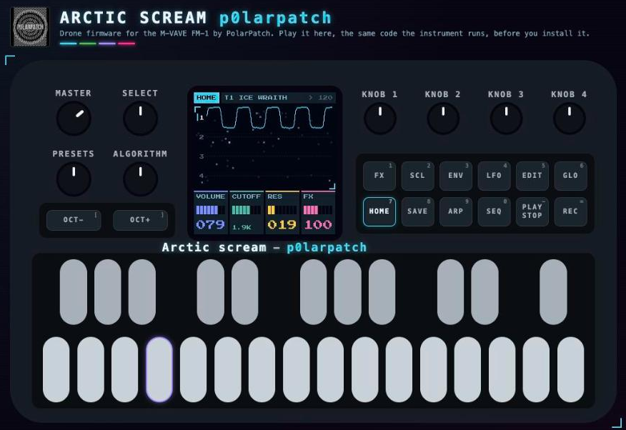

# Arctic Scream p0larpatch

**Dark ambient drones and feedback screams from the permafrost, for the M-VAVE FM-1.**

*Wind over the frozen tundra. Ice that groans under its own weight. Something out there in the polar night, howling back.*
Arctic Scream turns the FM-1 into an instrument for that: slow, cold drones that hum for minutes, and a voice that wakes on its own and screams.

[](https://polarpatch.github.io/Arctic-scream-FM-1/)

<a href="https://buymeacoffee.com/p0larpatch"></a>

Arctic Scream p0larpatch is a drone firmware for the FM-1 by PolarPatch. It is built on [GR!MM](https://github.com/GRiMMBIENT/grimm) and keeps what GR!MM does well: four tracks, long dark effects, a 64-step sequencer, chords, an arpeggiator and song mode. It adds a new voice, an arctic sound, a new look and its own editor.

**Try it in your browser first:** the **[demo](https://polarpatch.github.io/Arctic-scream-FM-1/)** runs the same code as the instrument, so you can play it before you install it. Then open the **[editor](https://polarpatch.github.io/Arctic-scream-FM-1/editor.html)** and the **[cheat sheet](https://polarpatch.github.io/Arctic-scream-FM-1/cheatsheet.html)**.

Free and open source (GPL-3.0). Unofficial firmware, not made or endorsed by M-VAVE or GR!MM. **Install at your own risk.**

---

## What's new

- **Holvut, a feedback-loop sound source.** (*Holvut* is North Sami for to howl.) It is inspired by the Synthux Audrey II and written from scratch for the FM-1. A string and a resonant body sit inside a loop with saturation, filters and diffusion.
  - Below the threshold the loop sleeps. Past it, the loop wakes and grows out of silence into a howl that sustains itself.
  - Each key press sends a short burst into the loop, so a note played near the threshold sets it off.
  - **FEEDBACK** wakes it, **BODY** bends it, **DAMP** turns the scream into a growl, and **DRIVE** tears it.
- **DRONE, a sound that lives on its own.** Press LFO twice. The knobs have North Sami names:
  - **BORGA** (snowdrift): four slow random walks move the filter, the source's shape and its own most natural knob, and the reverb's distance. Each voice drifts a few cents and breathes, so a held chord sounds like a choir. It never repeats.
  - **STOARBMA** (storm): the tension. It opens the filter, raises resonance and drive, spreads the voices and makes the walks deeper and faster.
  - **GOHCCAT** (to wake): 1 to 32 bars for the storm to rise, in tempo. A drone woken from silence starts calm and builds.
  - At 0 % the sound is exactly as set. The settings are saved with the sound, and all six screaming presets start with BORGA on.
- **Six screaming presets:** POLAR HOWL, WENDIGO, FROZEN SCREAM, WHITEOUT, DEAD SIGNAL and ICE WRAITH. ICE WRAITH is the sound you start with, and all six hold their notes (LATCH).
- **The HORROR scale:** close semitones, so every note is wrong in the right way.
- **Runaway echo:** DELAY feedback goes up to 150 %, so the echo can grow and saturate. Delay times go up to 3 seconds.
- **Built for drones:**
  - The keys sit an octave down, starting at F2.
  - The track defaults are darker.
  - The knobs on HOME, EDIT and LFO all audibly change the sound from the start.
  - HOME's knobs set the selected track's VOLUME, CUTOFF, RESONANCE and FX, and show their values.
- **46 factory sounds** with arctic names, such as POLAR NIGHT, PERMAFROST, SVALBARD CELLO and NORTHERN LIGHT.
- **A new look:**
  - an arctic cyberpunk palette from PolarPatch's BlueWatch;
  - waveforms that glow on HOME;
  - aurora ribbons that move with Holvut's knobs and with DRONE's walks;
  - moving northern lights on the FX, LFO and mixer pages too: TAPE's four ribbons, GRAIN's torn-off grains of light, DELAY's echoes (burning magenta when they run away), SPACE's hanging curtain, the LFO's band, and the mixers' curtains and crests;
  - the PolarPatch logo over drifting northern lights at boot.
- **A one-page [cheat sheet](https://polarpatch.github.io/Arctic-scream-FM-1/cheatsheet.html)** with every button, knob and combo, and a guide to summoning the screams.

## The editor

The **[editor](https://polarpatch.github.io/Arctic-scream-FM-1/editor.html)** runs in Chrome or Edge and talks to the FM-1 live over USB. It also works without an FM-1, with the firmware running inside the page.

- **Sound:** every parameter of the four tracks, live as you move it, with the instrument's screen and keys beside it.
- **Sound tools:**
  - undo and redo;
  - compare with the sound as you loaded it;
  - store an A and a B sound, then switch or morph between them;
  - randomize by any amount.
- **Sequencer:** a step grid, a piano roll or a typed step list, with tempo, play and stop, a playhead, and MIDI files in and out.
- **Library, samples and backup:** a sound library with 64 user slots, uploading WAVs into the four sample slots, and full backup and restore.

## Install

Download `arctic-scream-X.Y.fwsc` (the newest) from [Releases](../../releases). Then, with Python 3 and `pip install mido python-rtmidi`, connect the FM-1 over USB and run:

```
python3 tools/fm1_install.py arctic-scream-1.0.fwsc
```

Every release is built and signed on GitHub from the tagged source (the FM-1 Firmware Hub's [fm1-build](https://github.com/zvenson/fm1-build)); check a file with `gh attestation verify arctic-scream-1.0.fwsc --repo PolarPatch/Arctic-scream-FM-1 --signer-workflow zvenson/fm1-build/.github/workflows/build.yml`.

It installs over the FM-1's own firmware, GR!MM or any other FM-1 firmware. Don't unplug the FM-1 while it writes. If anything goes wrong, the **Rescue** page on the [FM-1 Firmware Hub](https://thefirmwarehub.com/) brings a stuck FM-1 back, and M-VAVE's own updater puts the original firmware back.

## Good to know

- **Saves:** Arctic Scream keeps its own saves, separate from GR!MM's. If you come from GR!MM, your projects and slots start empty.
- **Samples:** no samples are built in. The four slots are yours to fill from the editor, and samples already on your FM-1 stay.
- **Learn it:** the [manual](MANUAL.md) (GR!MM's, with Arctic Scream's changes) and the [cheat sheet](https://polarpatch.github.io/Arctic-scream-FM-1/cheatsheet.html).

## Credits

- **[GR!MM](https://github.com/GRiMMBIENT/grimm)** (GPL-3.0): the firmware this is built on, and everything GR!MM itself builds on: Felucca, Dinghy, SLOOP, X0X, msfa, DaisySP, Rings and CrispyZebra.
- **[Audrey II](https://github.com/Synthux-Academy/Audrey-II)** and **[Audrey Touch](https://github.com/Synthux-Academy/AudreyTouch)** by Nick Donaldson (Infrasonic Audio) and Synthux Academy (MIT): the design behind Holvut and the HORROR scale. No code is copied.
- **[Jangada](https://github.com/zednaked/jangada)** by zednaked (GPL-3.0): the idea behind the DRONE page (its EVOL, TENS and RAMP). Written from scratch; no code is copied.
- **[BlueWatch](https://github.com/PolarPatch/BlueWatch)** by PolarPatch: the colour palette.
- **Press Start 2P** font by CodeMan38 and **Terminus** font by Dimitar Zhekov (SIL Open Font License 1.1).

The PolarPatch logo belongs to PolarPatch and is not under the GPL. See [LICENSING.md](LICENSING.md) for the details.

## Support

Arctic Scream is free and always will be. If it is useful to you and you would like to say thanks, you can
[buy PolarPatch a coffee](https://buymeacoffee.com/p0larpatch).

## Building from source

See [docs/BUILDING.md](docs/BUILDING.md).

## Licence

GPL-3.0. See [LICENSE](LICENSE). Bugs and questions: open an issue on this repository.
