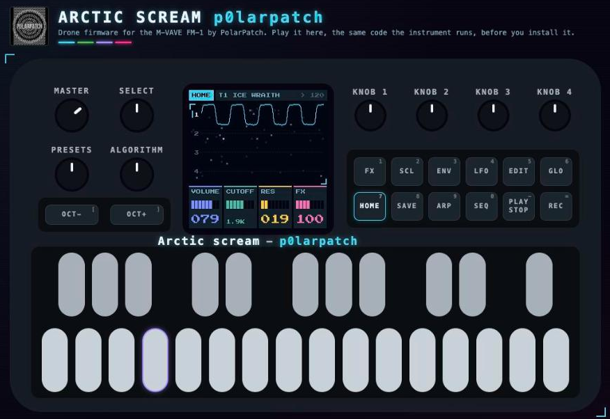

# Árktalaš holvvas // Arctic Scream

**Dark ambient drones and feedback screams from the arctic tundra, for the M-VAVE FM-1.**

*Wind over the frozen tundra. Ice that groans under its own weight. Something out there in the polar night, howling back.*
Arctic Scream turns the FM-1 into an instrument for that: slow, cold drones that hum for minutes, and a voice that wakes on its own and screams.

[](https://polarpatch.github.io/Arctic-scream-FM-1/)

<a href="https://buymeacoffee.com/p0larpatch"></a>

Arctic Scream p0larpatch is a drone firmware for the FM-1 by PolarPatch. It has four tracks, long dark effects, a 64-step sequencer, chords, an arpeggiator and song mode, and comes with its own feedback voice, an arctic sound, a new look and its own editor.

**▶ [Watch the Arctic Scream demo on YouTube](https://youtu.be/MJ53VOVRIG8)**: Holvut, DRONE, the effects and the sequencer, played by the firmware itself.

**▶ Demo: [Arctic Scream 1.4](https://www.youtube.com/watch?v=ny85eI50NK8)**: Holvut's LOOP page and FX's AIR page.

**▶ Review: [Arctic Scream Test](https://www.youtube.com/watch?v=zt_Ej7tA8n0)** by [CCJmusic](https://www.youtube.com/@ccjmusic).

**Try it in your browser first:** the **[demo](https://polarpatch.github.io/Arctic-scream-FM-1/)** runs the same code as the instrument, so you can play it before you install it. Then open the **[editor](https://polarpatch.github.io/Arctic-scream-FM-1/editor.html)** and the **[cheat sheet](https://polarpatch.github.io/Arctic-scream-FM-1/cheatsheet.html)**.

Free and open source (GPL-3.0). Unofficial firmware, not made or endorsed by M-VAVE. **Install at your own risk.**

---

## What's new

- **Howl/Holvut, a feedback-loop sound source.** (*Holvut* is North Sami for to howl.) It is inspired by the Synthux Audrey II and written from scratch for the FM-1. A string and a resonant body sit inside a loop with saturation, filters and diffusion.
  - Below the threshold the loop sleeps. Past it, the loop wakes and grows out of silence into a howl that sustains itself.
  - Each key press sends a short burst into the loop, so a note played near the threshold sets it off.
  - **FEEDBACK** wakes it, **BODY** bends it, **DAMP** turns the scream into a growl, and **DRIVE** tears it.
  - New in 1.3: push **FEEDBACK** to its last steps and the howl **overblows**: it leaps up the note's overtones and screams higher. Play from a MIDI keyboard with **aftertouch** and pressing harder does the same: the note feeds back more, screams and climbs, and falls back when you ease off.
  - **BODY** now reaches ~92 ms, for slow pulses at the top of its range; four all-passes in the loop smear the scream like a small reverb.
- **New in 2.2 (in the making):**
  - **JAHKI** (year; press LFO five times): the Arctic's year turning slowly under the music, through the Sami year's
    eight seasons, from DALVI's polar night to GEASSI's midnight sun and CAKCA's autumn fog, each leaning the filters,
    the reverb and SHIMMER a little. A year can take 8 minutes or 24 hours, or stand STILL.
  - **The pictures move:** the aurora breathes, snow drifts, water glitters, the lighthouse's beam turns.
  - **The ice holds its breath:** with RUOHČAT up, the reverb's tail is held still for a few seconds now and then.
  - **JIEHKKI's dusk:** as a piece dies out, its tracks go one by one, the highest first, till one low note fades alone.
    **START ALWAYS:** the piece begins by itself every time the FM-1 is switched on.
  - **The keys as a display:** the piece's notes lit, RUOHČAT's cracks and drips flashing across the keys.
- **New in 2.1 (in the making):**
  - **A picture for every sound.** Turn PRESETS and HOME shows the sound's picture a moment: a glacier, the aurora, an
    ice cave, a fjord, a snowstorm. SYSTEM 3's PICTURE can keep it as HOME's sky, under the waves.
  - **The ice answers.** With RUOHČAT up, a note you play may come back a few seconds later from far off in the ice,
    an octave up, a bell of ice.
  - **EVOLVE**, a new PLAY MODE: the pattern changes a little each time round, so a loop never repeats the same way.
  - **JIEHKKI all night:** LENGTH 2, 4 or 8 hours.
- **New in 2.0: the drone machine.** The names are North Sami, checked in the dictionary at sanit.oahpa.no.
  - **JIEHKKI** (glacier; press LFO three times): set a LENGTH, 5 to 60 minutes or ENDLESS, and START. With nothing playing, the FM-1 plays a whole piece by itself, a note on each track from your SCALE, rising out of silence, moving as slowly as a glacier (DRIFT), and dying out at the end. Then it stops, the screen goes dark and it stays silent until you touch it. With DRIFT at 0 it is a sleep timer for your own drone.
  - **RUOHČAT** (to creak), on the same page: the ice around the drone, cracks, drips and a deep boom now and then, from one a minute to a storm.
  - **ŠUOKŊA** (a tone and its sound; SEL, KNOB 3): pure tunings for drones. JUST, PYTHAG and HARMONIC, so a held chord stands still instead of beating, or takes on the strange colours of the harmonic series.
  - **Biegga** (wind), a ninth sound source: noise that sings at the note like wind in a gap, with GUST, HOWL, TONE and SNOW, and a factory sound of its own, BIEGGA.
  - **Jiekna** (ice, 2.2), a tenth: ice that sings when struck or bowed, with STRIKE, RING, HOLLOW and BRITTLE.
  - **GUOVSSAHAS** (the northern lights): a new SCREEN OFF choice. After two minutes untouched the screen turns into a night sky with three aurora curtains folding over the stars (after pixelfx's Aurora, by Patch).
  - **COLOUR MONO**: the whole screen in black and white, its greys as fine dots, as on an old one-bit screen.
  - **DICE** (hold SEQ, press G3 to G4): a new part on the track in one of eight moods, from HUSH and STILL to ARP and MACHINE. The still moods slow the pattern so a drone's attack has time to bloom.
  - **ACCIDENT** (hold EDIT, press E4, F4 or G4): two or three of the track's settings move at random, a little, more or wildly, the knobs gliding there. EDIT + OCT− undoes it. DICE and ACCIDENT follow ideas from KRIECHSTROM, written anew.
  - **PRESETS blend.** Turning PRESETS under a sounding drone crossfades into the next sound, or glides the knobs when the source is the same, instead of jumping.
  - **ATTACK swells in.** A note stays faint for most of a long ATTACK and blooms at the end, so a new key flows into the drone.
  - **MASTER is louder** through its range (half way about 9 dB under the top, where it was 18) and the output is 3 dB stronger.
  - **38 factory sounds**, leaner and more drone: the keys, leads and plucks gave way to BIEGGA, RIDDU and POLAR STILL. SIGNAL FLARE stays.
  - **The browser player takes your own WAVs**, up to about 95 seconds each, in a SAMPLES box beside it.
  - MIDI notes and the clock come in while the screen is drawing, and the update process has tests of its own.
- **New in 1.5.2:**
  - **A screen while it updates.** Installing no longer leaves the screen black: the FM-1 shows UPDATE MODE and what it waits for, then WRITING with a bar and the per cent, and DONE or what to do if it failed.
  - **MOD OUT** (SYSTEM 3): each track's level and LFO go out over USB as MIDI CC 102 and 103, 50 times a second, to drive lights, motors, a Max patch or another synth. Off by default.
  - **PANEL OUT**, an open protocol for apps: which buttons and keys are down and how the knobs turn, so an app can draw the FM-1 as you play it. Silent until an app asks. See [docs/PANEL_OUT.md](docs/PANEL_OUT.md).
  - **The browser demo plays in tune** in browsers that run their audio at 48 kHz.
  - **More room inside.** DELAY's longest time is now 2.6 s (PING-PONG 1.3 s), which frees memory for what comes next; the steps up to 1.94 s are as before.
- **New in 1.5.1: the newer FM-1s.** FM-1s sold since autumn 2026 carry another flash chip (UC25HQ80). Arctic Scream 1.5 did not know it, so on those units it kept the saves only until power-off and refused updates. 1.5.1 saves and updates on both chips. On such a unit with 1.5 on it, install 1.5.1 through the chip's download mode (see [Install](#install)).
- **New in 1.5:**
  - **A screen reader.** Arctic Scream says what its screen shows: pages, knobs as they turn, lists and messages. Open the [FM-1 Screen Reader](https://charlesvestal.github.io/fm1-reader/) in Chrome or Edge, connect, and it speaks with its own voice or through VoiceOver, NVDA, JAWS or TalkBack. See the [manual](MANUAL.md#the-screen-reader-new-in-15).
  - **Saves under a drone.** A latched drone never falls silent, and the FM-1 used to wait for silence before it saved. Now a slot or a sound you save is written at once, and the automatic save goes through after 30 s left alone.
  - **Projects keep their effects.** The [editor](https://polarpatch.github.io/Arctic-scream-FM-1/editor.html) saves a project with its effects and tempo, and offers to set them when it loads one.
  - **TAPE's TONE shows its corner** as CUTOFF does: `OPEN`, `10K` … `400` (it darkens as it turns up, the opposite way to DRIVE's TONE).
- **New in 1.4:**
  - **Holvut's LOOP page** (press EDIT twice on a Holvut track): **GATE** lets the howl die into its own tail when you let go of the key; **BLOOM** feeds the grain, the echoes and the reverb back into the loop, so the scream grows inside its own effects; **LOWCUT** thins the loop from ~70 Hz up to ~1.9 kHz; **EXCITE** plays the track's sample into the string, so your own sound wakes the howl.
  - **AIR**, FX's new last page: **PING-PONG** throws DELAY's echoes left, right, left; **SHIMMER** sends SPACE's tail up an octave and back into the reverb, so it rises as it fades.
  - **USB LEVEL** on SYSTEM 3: how loud a computer records the FM-1, −12 to +24 dB.
  - Quieter headphones on wide, loud sound: a limiter on the difference between left and right stops the FM-1's headphone amplifier from crackling. The middle of the sound and the USB recording are untouched.
  - The key lights of latched and arpeggiated notes follow OCT− and OCT+.
- **New in 1.3.1:** **USB audio on macOS 10.14 to 15.** Up to 1.3 those Macs saw the FM-1 but never showed its audio input (MIDI worked); the newest macOS took it. And a computer now records the FM-1 at full level whatever the volume knob says: the knob sets the speaker and the headphones, not the recording.
- **New in 1.3:**
  - **GENERATE:** hold FX and tap a black key, and that track plays by itself, always in its SCALE (in chords with chord mode on), in three moods: DRIFT, PULSE and STORM. It sits beside DRONE: one moves the sound, the other the notes.
  - **MASTER and DRIVE:** two new FX pages. MASTER is a filter on the whole mix (LP, HP or BP, before the effects, after the reverb or at the very end). DRIVE's AMOUNT tears the whole mix (SOFT, FUZZ, CLIP or FOLD), each type about as loud as the others, a limiter after it.
  - **The track filter** gets a TYPE (LP, HP, BP) and a POS (PRE or POST the effects) on MIXER 2.
  - **MIDI clock** in (USB or the TRS jack) and out (USB), **MIDI in on the TRS jack** with a TRS-to-DIN adapter, and one MIDI channel to the selected track (CH n > SEL).
  - **6 dB of headroom and a safety limiter**, so loud screams no longer clip; a drone keeps its voices when another track plays a big chord.
  - **WARP and MORPH** on HOME (RESONANCE moved to MIXER 2), and bigger FX: TAPE's wow, saturation, tone and hiss reach much further, DELAY's WEAR wobbles and drives harder, and turning GRAIN or DELAY up on a track that sends nothing turns its send on.
  - LATCH from any page (SEL + OCT+), REC held to clear a pattern, backups with your samples, cleaner USB recording (USB REC DROPS on SYSTEM 2), and saves that no longer wait for ever under a delay that feeds back for ever.
- **DRONE, a sound that lives on its own.** Press LFO twice. The knobs have North Sami names:
  - **BORGA** (snowdrift): four slow random walks move the filter, the source's shape and its own most natural knob, and the reverb's distance. Each voice drifts a few cents and breathes, so a held chord sounds like a choir. It never repeats.
  - **STOARBMA** (storm): the tension. It opens the filter, raises resonance and drive, spreads the voices and makes the walks deeper and faster.
  - **GOHCCAT** (to wake): 1 to 32 bars for the storm to rise, in tempo. A drone woken from silence starts calm and builds.
  - At 0 % the sound is exactly as set. The settings are saved with the sound, and all seven screaming presets start with BORGA on.
- **Seven screaming presets:** POLAR HOWL, WENDIGO, FROZEN SCREAM, WHITEOUT, DEAD SIGNAL, III and ICE WRAITH. ICE WRAITH is the sound you start with, and all seven hold their notes (LATCH). III is a horrorscape: a cluster of three howling voices a semitone apart, dark and slowly waking ([how to play it](docs/iii/iii_en.md)).
- **The HORROR scale:** close semitones, so every note is wrong in the right way.
- **Runaway echo:** DELAY feedback goes up to 150 %, so the echo can grow and saturate. Delay times go up to 2.6 seconds.
- **Built for drones:**
  - The keys sit an octave down, starting at F2.
  - The track defaults are darker.
  - The knobs on HOME, EDIT and LFO all audibly change the sound from the start.
  - HOME's knobs set the selected track's VOLUME and CUTOFF, and two that twist it: **WARP** (eight layers of motion, from a still sound to a wild one, smoothly) and **MORPH** (one knob through all four of the source's knobs at once, never quite still).
- **38 factory sounds** with arctic names, such as POLAR NIGHT, PERMAFROST, SVALBARD CELLO, POLAR STILL and BIEGGA.
- **A new look:**
  - an arctic cyberpunk palette from PolarPatch's BlueWatch;
  - waveforms that glow on HOME;
  - aurora ribbons that move with Holvut's knobs and with DRONE's walks;
  - moving northern lights on the FX, LFO and mixer pages too: TAPE's four ribbons, GRAIN's torn-off grains of light, DELAY's echoes (burning magenta when they run away), SPACE's hanging curtain, the LFO's band, and the mixers' curtains and crests;
  - at power-on, ARCTIC SCREAM tears itself out of the dark in a glitch storm and settles into the banner's glitch.
- **A one-page [cheat sheet](https://polarpatch.github.io/Arctic-scream-FM-1/cheatsheet.html)** with every button, knob and combo, and a guide to summoning the screams.

## The editor

The **[editor](https://polarpatch.github.io/Arctic-scream-FM-1/editor.html)** runs in Chrome or Edge and talks to the FM-1 live over USB. It also works without an FM-1, with the firmware running inside the page.

- **Sound:** every parameter of the four tracks, live as you move it, with the instrument's screen and keys beside it.
- **Sound tools:**
  - undo and redo;
  - compare with the sound as you loaded it;
  - store an A and a B sound, then switch or morph between them;
  - randomize by any amount.
- **Sequencer:** a step grid, a piano roll or a typed step list, with tempo, play and stop, a playhead, and MIDI files in and out.
- **Library, samples and backup:** a sound library with 64 user slots, uploading WAVs into the four sample slots, and full backup and restore.

## Install

Download `arctic-scream-X.Y.fwsc` (the newest) from [Releases](../../releases). Then, with Python 3 and `pip install mido python-rtmidi`, connect the FM-1 over USB and run:

```
python3 tools/fm1_install.py arctic-scream-2.0.fwsc
```

Every release is built and signed on GitHub from the tagged source (the FM-1 Firmware Hub's [fm1-build](https://github.com/zvenson/fm1-build)); check a file with `gh attestation verify arctic-scream-2.0.fwsc --repo PolarPatch/Arctic-scream-FM-1 --signer-workflow zvenson/fm1-build/.github/workflows/build.yml`.

It installs over the FM-1's own firmware or any other FM-1 firmware. Don't unplug the FM-1 while it writes. If anything goes wrong, the **Rescue** page on the [FM-1 Firmware Hub](https://thefirmwarehub.com/) brings a stuck FM-1 back, and M-VAVE's own updater puts the original firmware back.

**A newer FM-1 with Arctic Scream 1.5 or older on it** (saves gone after power-off, `SAVE ERROR`, every update refused): the FM-1 is fine, the old version only knows the first flash chip. Don't install again and again. Put 1.5.1 on through the chip's USB download mode instead, with [m-flasher](https://github.com/jvitkauskas/m-flasher/releases) or the steps on the Firmware Hub's [Rescue page](https://thefirmwarehub.com/tools/rescue/#chip). From 1.5.1 on, updates install the normal way.

In the chip's download mode, Windows may ask to format the FM-1 as a disk. Always click **Cancel**: never format it.

## Good to know

- **Saves:** Arctic Scream keeps its own saves, separate from other FM-1 firmwares. If you come from another one, your projects and slots start empty.
- **Samples:** no samples are built in. The four slots are yours to fill from the editor, and samples already on your FM-1 stay.
- **Learn it:** [every feature in one overview](FEATURES.md), the [manual](MANUAL.md), the [visual manual](https://polarpatch.github.io/Arctic-scream-FM-1/manual.html) ([PDF](docs/manual/arctic-scream-manual.pdf)) and the [cheat sheet](https://polarpatch.github.io/Arctic-scream-FM-1/cheatsheet.html).

## Credits

- **[GR!MM](https://github.com/GRiMMBIENT/grimm)** (GPL-3.0): the firmware this is built on, and everything GR!MM itself builds on: Felucca, Dinghy, SLOOP, X0X, msfa, DaisySP, Rings and CrispyZebra. 1.3 brings in much of GR!MM V2.0: GENERATE, MASTER, DRIVE, the track filter's TYPE and POS, the MIDI clock and TRS MIDI IN, the gain staging and its fixes.
- **[Audrey II](https://github.com/Synthux-Academy/Audrey-II)** and **[Audrey Touch](https://github.com/Synthux-Academy/AudreyTouch)** by Nick Donaldson (Infrasonic Audio) and Synthux Academy (MIT): the design behind Holvut and the HORROR scale. No code is copied.
- **[Jangada](https://github.com/zednaked/jangada)** by zednaked (GPL-3.0): the idea behind the DRONE page (its EVOL, TENS and RAMP). Written from scratch; no code is copied.
- **[ECHOFIELD](https://github.com/Philip-Bos/echofield-fm1)** by Philip Bos (MIT): the ideas behind 1.4's PING-PONG, SHIMMER and the side limiter, and its measurements of the FM-1's headphone amplifier. Written again in integers; no code is copied.
- **Book of the Dead II** by DigDugDIY: the FX loop inside the feedback that became the LOOP page's BLOOM. An idea only; it is hardware.
- **[FM-1 Screen Reader](https://github.com/charlesvestal/fm1-reader)** by Charles Vestal: the reader page and its protocol; `firmware/src/announce.c` and `tools/gen_words.py` are [fm1-base](https://github.com/charlesvestal/fm1-base)'s (MPL-2.0).
- **[BlueWatch](https://github.com/PolarPatch/BlueWatch)** by PolarPatch: the colour palette.
- **Press Start 2P** font by CodeMan38 and **Terminus** font by Dimitar Zhekov (SIL Open Font License 1.1).

The PolarPatch logo belongs to PolarPatch and is not under the GPL. See [LICENSING.md](LICENSING.md) for the details.

## Support

Arctic Scream is free and always will be. If it is useful to you and you would like to say thanks, you can
[buy PolarPatch a coffee](https://buymeacoffee.com/p0larpatch).

## Building from source

See [docs/BUILDING.md](docs/BUILDING.md).

## Licence

GPL-3.0. See [LICENSE](LICENSE). Bugs and questions: open an issue on this repository.
